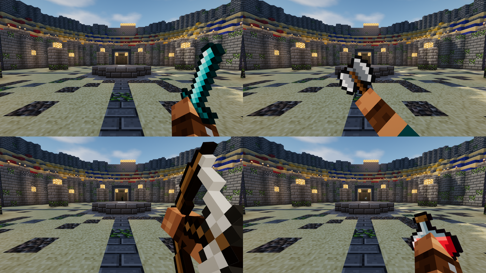
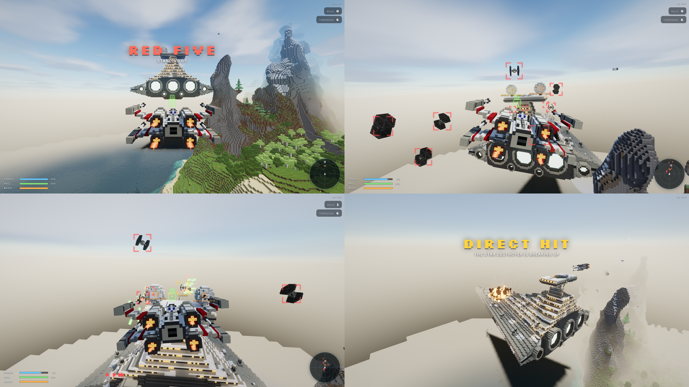

# Building games on Blockyard

The platform is a complete voxel engine: an endless procedural world, lighting, rendering, physics, streaming, entities, items, combat, audio and UI. You write the *game*: rules, content and moments. A game lives in `src/games/<name>/` and imports only from `@platform` (plus the optional `@platform/kits` and `@platform/art` libraries, which are themselves built only on `@platform`, and `@platform/client` in its client code).

Every game is played on a game server: its rules run there, and each player's browser draws what it sends. So a game comes in parts, by where they run:

| File | Made with | Runs | What goes in it |
| --- | --- | --- | --- |
| `meta.ts` | `defineMeta` | the launcher, and both sides | what the home page lists: `id`, `title`, `tagline`, `accent`, `cover`, `controls`, `gamepad`, `instances`, `achievements`. Tiny, and it imports nothing but `@platform` (and its cover picture, by URL) |
| `shared.ts` | `defineShared` | the server and every screen | what both sides must agree on: `world` (terrain, `structures`, `terraform`, `destructible`), `blocks` and their painters, `player` (movement, abilities, hotbar, skin, model), `guns`, `vehicles`, `hud`, `cheats`. Data, and pure functions both run the same way (structure builders, block painters, vehicles' and abilities' steps). It starts from the meta: `defineShared({ ...meta, world: { ... } })` |
| `server.ts` | `defineServer(shared, { setup, start, update })` | the server only | the rules: items and entities, events, bots, scoring, the HUD calls. Never sent to a browser |
| `client.ts` | `defineClient(shared, { ... })` (`@platform/client`) | each player's screen only | what the screen does of its own: the kits it uses (`@platform/client/kits`), and its own code (see "Client code") |

Other files in the folder are helpers any part may import (maps, weapon tables, painters), except that `meta.ts` imports none, shared code and client code never reach `server.ts`, neither `server.ts` nor shared code reaches client code, and only server code uses `@platform/kits` (the kits are server rules). A `client/` folder holds client code. `npm run check:boundaries` enforces all of it, following imports through helpers; after a production build, `npm run build` also checks that no server-only module ended up in the browser's output (`scripts/check-bundle.mjs`). A folder holding several small games (previews) prefixes their parts: `previews/shipyard.meta.ts`, `previews/shipyard.server.ts`.

Two registries list the games: `src/games/browser.ts` (each game's meta, and its client code loaded when someone picks it, as a chunk of its own: nothing else of a game reaches the page) and `src/games/server.ts` (each game's `server.ts`, which brings its shared code). Development games (previews, the model gallery, High Noon) are in both registries' `devGames`: they open by id (`?game=gallery`, not listed), only in a development build, on a development server.

`defineGame({...})` still makes a whole game in one object (shared definition and rules together), for tests and scratch games a server runs directly (`launch(myGame)` in a headless test); a game in `src/games` is split.

```
src/games/
  browser.ts            the browser's catalog: metas, and client code loaded on demand
  server.ts             the server's registry: each game's rules and shared definition
  heart-hunt/           ~70 lines: the tutorial below
    meta.ts shared.ts server.ts client.ts
  sandbox/              creative building, with a few blocks of its own (in shared.ts)
  arena/                waves of monsters, weapons, a boss
    server.ts           rules: waves, rewards, win/lose
    content.ts          items, monsters, boss AI
    structure.ts        the colosseum, as a Blueprint (shared.ts puts it in the world)
    art/                the mob skins and weapon sprites, painted in code into the 'arena' atlas
    client/sounds.ts    creature voices (client.audio.define)
  skyship/              an airship crewed together: a solid prop the players walk on as it sails
    server.ts           the helm, sailing, beacons, overboard, the HUD
    ship.ts world.ts    the airship and the sky islands, as Blueprints
    client/sounds.ts    the beacon's bell, the hull's thud (client.audio.define)
  starfighter/          a Star Fox-style dogfighter: no walking, the game flies the camera
    server.ts           waves, HUD, win/lose
    shared.ts flight.ts the Vox-wing as a vehicle (its step runs on the pilot's screen too)
    ships.ts            the fighters, as Blueprints (meshed into movable props)
    destroyer.ts        the capital ship, as a world structure
    craft.ts pilot.ts enemies.ts weapons.ts capital.ts   collisions, AI, lasers, the boss
    client/sounds.ts    lasers, torpedoes, the capital ship's horn, the Bowtie howl (client.audio.define)
    layout.ts           where the battle is
    previews/           dev-only previews of the ships and the capital ship
  bedwars/              Bed Wars: four teams of up to four (people, bots in the rest), a lobby, sky islands, mining, building, a shop
    server.ts           rules: generators, beds, deaths and respawns, the timeline, win/lose
    map.ts              the islands, as Blueprints in a void world
    state.ts            teams, the match, block rules and mining times (for the building kit)
    bots.ts nav.ts      bot players: route-finding that bridges and digs, fighting, raiding
    shop.ts items.ts    the shopkeeper's menu and everything it sells
    fireballs.ts        thrown fireballs that blast wool and wood
    art/ sounds.ts      team skins, item sprites, sounds
  callofblocky/         Call of Blocky: a pulp shooter against bots and people, three modes on two maps
    server.ts           rules: the match and its mode, teams, spawns, kills, streaks, loadouts, the HUD
    modes.ts            the modes (free-for-all, Team Deathmatch, The Briefcase), the teams, the rotation
    match.ts            the match as the server's parts share it: the fighters, the mode, the map, the score
    briefcase.ts        The Briefcase's rounds: planting and cracking the case, one life a round, the bots' roles
    shared.ts           the maps, movement, the fighters' models, the HUD theme, its own blocks (blocks.ts)
    weapons.ts          what the guns (kind 'gun'), the katana and the lethals (kind 'throwable') do
    client.ts           the kits it uses, listed; its looks and voices (client/)
    client/looks.ts     how each weapon looks: its model, icon, first-person hold, tracer, trail, sounds
    client/sounds.ts    gunshots, reloads, the lethals, the case's fuse, the stingers (client.audio.define)
    bots.ts             bot fighters (game.bots) on the navGrid kit, the mode saying who's fair game and where to go
    map.ts maps/        the maps, far apart in one void world: Jackrabbit Lane (a Nuketown-style street) and
                        Big Kahuna Burger (a burger joint, its lot, a motel round a drained pool), as Blueprints
    models/             the guns and fighters as GLB files (tools/ writes them; the guns reached only by client code)
    art.ts              the pulp wardrobe (skins painted in code)
    hud.css hud.ts      its HUD: the comic-book theme (hud.theme.css), its corner widget, the team modes' bar, the vote's card
    progression.ts      XP, levels 1 to 30 and what they unlock, kept for each account (player.store); the loadout's locks
    client/progression.ts  the XP bar, the ticker of gains, level-ups and the match's XP: a client kit of its own
  blockfront/           Blockfront II: Rebels against the Empire, third person, over the command posts of a desert spaceport
    server.ts           rules: sides, classes, spawning at posts, battle points and heroes, the deploy menu, the HUD calls
    conquest.ts         the posts (taken by standing in them) and the tickets (deaths and the bleed); modes.ts: Conquest, Heroes vs Villains
    weapons.ts          blasters (kind 'gun', their magazine the heat: they overheat and cool) and the thermal detonator
    heroes/             the heroes: a saber item kind of its own (combos, the guard that deflects bolts), eleven Force
                        powers, hero bots; client/: the figures kit copied and taught saber stances and Force poses,
                        the powers' effects, the hero HUD
    client/             bolts you can watch fly, the third-person crosshair and heat, voices, ambience; skies.ts: fighters overhead
    maps/ tools/        Mos Blockley Spaceport as Blueprints; the voxel troopers, heroes and weapons built in code
  blockjam/             Block Jam: two-on-two arcade basketball (NBA Jam-style): big heads, turbo, dunks, catching fire
    court.ts ball.ts    the court's numbers; the ball's flight (rims, the board, the net), played the same on every screen
    moves.ts            the ballers' movement ability: steering by the screen, turbo, jump shots, seven dunks, knockdowns
    server.ts match.ts  rules: the roster (bots in empty places), possession, shots, blocks, steals, shoves, fire, the clocks
    pick.ts levels.ts   the team screen (M: pick a team, the first person in starts a new game; the bots' level), and the
                        levels (Rookie, Pro, All-Star): how the bots facing people guard, reach, shoot and run
    bots.ts             bot ballers: drives, pull-ups and threes, passes and lobs, defence, rebounds
    client/             the broadcast camera, the ball and the baskets drawn, the poses (big heads, dunks), the announcer, the crowd
    tools/models.mjs    the ball, the baskets, the nets and the court's markings, built in code
  blockice/             Block Ice: two-on-two arcade hockey (NHL Open Ice-style), a goalie each: big heads, turbo, slap shots,
                        one-timers, checks into the glass, catching fire
    rink.ts puck.ts     the rink's numbers (the boards, the goals); the puck's slide and flight (posts, the bar, the twine)
    moves.ts            the skaters' movement ability: steering by the screen, gliding on ice, hockey stops, turbo,
                        wind-ups, check lunges, knockdowns; a goalie's glide to its spot
    server.ts match.ts  rules: the roster, faceoffs, possession, shots, saves, blocks, pokes, checks, fire, the periods
    pick.ts levels.ts   the team screen (M) and the bots' levels (Rookie, Pro, All-Star)
    bots.ts goalies.ts  bot skaters (rushes, wristers and slappers, passes for one-timers, defence) and the goalies
    client/             the broadcast camera, the rink and goals drawn, everyone's gear (sticks, helmets, skates, goalie
                        pads), the poses (skating, shots, saves), the announcer, the organ, the goal horn
    tools/models.mjs    the puck, the boards, the goals and nets, the rink's markings, sticks, helmets and goalie gear
  golf/                 Blockyard Links: eighteen holes, a cart, a mouse swing, sloping greens
    course/             the holes as a yardage book (holes.ts), the land worked out from them (course.ts), its invisible footing in blocks (build.ts)
    physics.ts          the ball: flight (drag, Magnus lift, wind), bounces that dig into the turf, skid and roll, the cup
    clubs.ts            the bag, the lies, and how a swing (power, timing, strike point) becomes a launch
    cart.ts             the cart, as a vehicle over the course's smooth ground
    server.ts           rules: each golfer's round, the cart, stepping up to the ball, penalties, the card
    client/             the course drawn smooth (terrain*.ts: glTF files made in a worker, shown as items' models), the mouse swing
                        and its camera, the balls in flight, the panel, reading the greens
  obby/                 Sky Obby: a parkour course in the void, each player on their own clock
    server.ts           rules: checkpoints, falls, pads, blinking and crumbling blocks, cannons, times
    course.ts           the ten stages, laid out as Blueprints with every jump checked against the physics
    client/sounds.ts    checkpoint chime, pad boing, crumbling sand, cannons (client.audio.define)
  moves/                dev-only movement lab (`?game=moves`): a course for three movement abilities
    abilities.ts        a dash, a double jump, a wall-run with wall-jumps: pure steps to copy
```

## Hello, game

`src/games/heart-hunt/` is a complete game in about 70 lines. It builds a pedestal as a blueprint, flattens the land around it, scatters ten glowing hearts, counts pickups, shows a victory screen and awards three achievements (its meta lists them: see "Achievements"). What the launcher shows (`meta.ts`):

```ts
import { defineMeta } from '@platform';

export default defineMeta({ id: 'heart-hunt', title: 'Heart Hunt', tagline: 'A gentle hunt for ten hidden hearts', accent: '#ff5a7a' });
```

The home page shows the game on show large, with its `tagline`, over its world, and a card for every game along the bottom, in its `accent` colour. A card shows the game's `cover` if it has one: a 16:9 shot of the game (about 960×540, a WebP or JPEG under 100 KB) with no HUD or title on it, imported by URL (`import cover from './cover.webp?url'`, then `cover` in the meta). The same picture, blurred, fills the page while the game's world loads. The first few `controls` show under Play (the rest on asking), and the pause menu lists them all under How to play.

The world and the player, which the server and every screen read (`shared.ts`):

```ts
import { defineShared, Blueprint } from '@platform';
import meta from './meta';

const pedestal = new Blueprint({ x: -2, y: 70, z: -2 }, { x: 5, y: 3, z: 5 })
  .fill({ x: -2, y: 70, z: -2 }, { x: 2, y: 70, z: 2 }, 'stone_bricks')
  .set(0, 71, 0, 'glowstone');

export const shared = defineShared({
  ...meta,
  world: {
    structures: [pedestal],
    terraform: [{ x: 0, z: 0, radius: 12, blend: 16, height: 69.5 }],
    spawn: { x: 0.5, y: 72, z: 3.5 },
  },
  player: { health: 20, hotbar: 'items' },
});
```

The rules, on the server (`server.ts`):

```ts
import { defineServer } from '@platform';
import { shared } from './shared';

let found = 0;

export default defineServer(shared, {
  setup(game) {
    // What a heart does; how it looks is each screen's (client.ts).
    game.items.define('heart', {
      kind: 'misc', name: 'Heart',
      onPickup: (g, _count, player) => (found++, player.achieve('first_heart'), g.audio.play('pickup'), true), // consume on touch
    });
  },

  start(game) {
    found = 0;
    for (let i = 0; i < 10; i++) {
      const a = game.rng.range(0, Math.PI * 2), r = game.rng.range(8, 36);
      const x = Math.cos(a) * r, z = Math.sin(a) * r;
      game.items.spawnPickup('heart', { x, y: game.world.surfaceY(x, z) + 1.5, z }, { beam: '#ff5a7a', despawn: 1e9 });
    }
  },

  update(game) {
    game.hud.objective(`Hearts: ${found} / 10`);
    // ... at 10: everyone's player.achieve('all_hearts'), and game.hud.screen({ title: 'You win!', ... })
  },
});
```

And each player's screen (`client.ts`): the platform's kits it uses (the standard voices, the first-person view, other players' figures; see "Client code") and how its item looks there:

```ts
import { defineClient } from '@platform/client';
import { figures, firstPerson, sounds } from '@platform/client/kits';
import { shared } from './shared';

export default defineClient(shared, {
  kits: [...sounds.standard(), ...firstPerson.standard(), figures.humanoid()],
  setup(client) {
    client.items.look('heart', { icon: 'heart' }); // the built-in heart sprite
  },
});
```

Register it in both registries: `src/games/browser.ts` (its meta, and `() => import('./heart-hunt/client')`) and `src/games/server.ts` (its `server.ts`). Then `npm run dev` and open `http://localhost:5173/?game=heart-hunt`. The launcher lists every game in `browser.ts`.

## Lifecycle

The hooks are the rules in `server.ts` (`defineServer(shared, { setup, start, update })`):

| Hook | When | Use it to |
| --- | --- | --- |
| `setup(game)` | once, after the engine loads, before the world streams | define items and entity types, subscribe to events |
| `start(game)` | when the player first clicks play, and after `game.restart()` | reset state, give the starting kit, schedule the first beat |
| `update(game, dt)` | every frame while running (not paused) | rules, spawning, HUD |

A match the bots can play by themselves (an arcade's attract mode, shown to everyone watching from the home page) sets `autoStart: true` on its rules: `start` runs as soon as the ground at the spawn has loaded, and a player pressing Play joins it (`playerJoin`) rather than starting it. Block Jam does.

`game.restart()` clears entities, props, pickups, timers, the inventory and HUD, puts back any blocks broken, placed or shot into this session (unless the game sets `world.persist`), revives the player at the spawn point, lets go of any `freeze`, and calls `start` again. Keep your game state in plain module variables and reset it in `start`.

Game time (`game.clock.now`, `after`, `every`) pauses with the game. Prefer it over `setTimeout`. There are two clocks:
- `clock.now` is the match's: seconds of play since `start`, and a restart puts it back to 0 (clearing the timers with it). Times you keep from it (`roundStartedAt = game.clock.now`) belong to this match: reset them in `start`, or a round that began at 90 s looks 90 s in the future after a restart.
- `clock.total` is all the game's time since it first started, and a restart doesn't touch it: for what outlives a match (a cooldown across restarts, when someone joined).

A person's screen coming into play is its own moment: `playerReady` (after `start` for the first player, and right after `playerJoin` for anyone joining a server) is the place for what needs their screen, like a modal widget (see Presentation).

## World

`world` options on the definition:

- `structures: Blueprint[]`: voxel structures stamped **during generation** in the Rust workers. They are there from the first frame, cost nothing at runtime, and survive chunk reloads. Cells you never write keep the natural terrain; write `'air'` to carve.
- `terraform`: flatten terrain around a point (`radius` fully flat, `blend` back to natural). Terraformed and blueprint areas get no caves, trees or plants. The ground keeps the local biome's surface (grass, podzol, sand, snow), so if the floor matters, write it into your blueprint (the arena stamps a sand floor) or fix `seed`.
- `terrain: 'flat'` plus `flatHeight`: natural ground made flat (its biomes, trees and caves still made), at `flatHeight`.
- `terrain: 'void'`: nothing but your structures, floating in an open sky (Bed Wars and SkyWars islands). The sky wraps all the way round below the horizon, so there's no floor to see.
- `terrain: 'void'` with a `ground`: your structures on a plain slab, `ground: { y, top, fill, depth }` (its `top` block, grass by default, at `y`, over `depth - 1` of `fill`, dirt; 4 deep in all), as far as anyone sees, with a normal horizon. `terraform` shapes it: a height above `y` raises a hill (a backdrop, a ridge for a landmark to stand on), below it sinks a hollow. No noise, caves, water or plants are made, so it's the choice for a game played in one place: Call of Blocky's street and Arena's colosseum stand on one, and cost a fraction of a natural world to make and draw (Arena: from about 880 000 triangles a frame to 45 000).
- `maxViewDistance`: hold the player's view distance to this many chunks. A game played in a small space has nothing further to load, mesh and draw (the haze follows it, so keep backdrop landmarks within it).
- `spawn`, `spawnYaw`, `time` (0 = midnight, 0.5 = noon), `freezeTime`, `seed`, `persist` (save block edits and position; Sandbox uses it).
  At runtime `game.world.spawn` (`{ x, y, z, yaw }`) is where players come in (joining, `restart`) and what someone watching from the game's home page looks at. A game played in several places moves it to the one in play: Call of Blocky builds its two maps far apart in one world (`maxViewDistance` keeps only the near one loaded and drawn) and sets it to the map of each match, so the home page shows where the fight is to whoever opens it (anyone already watching keeps the view they came in with).
- `viewDistance`: a minimum view distance in chunks for games that see far (flight). The player's own setting wins if it's higher.
- `destructible`: blocks you can shoot holes in (see Blocks you can shoot holes in, below). Off by default.

`Blueprint` helpers: `set`, `fill(a, b, block | (x, y, z) => block)`, `columns(cx, cz, radius, (x, z, dist, angle) => …)` for rings and walls, `Blueprint.centered(cx, cz, radius, y0, y1)`, `moved(offset)` and `forEach`. See `src/games/arena/structure.ts`, which builds a whole colosseum in about 120 lines.

At runtime, `game.world` exposes `getBlock`, `setBlock` (lighting and meshing update automatically), `raycast`, `lineOfSight`, `surfaceY`, `blockId`, `blockName`, `seaLevel`, and `explode(center, radius)`, which blasts a ragged hole (all the affected chunks remesh together) with debris and an explosion (in a world with destructible blocks, a crater: below). With `damage` it hurts too: `explode(at, 1.5, { damage: [160, 20], reach: 5.5, knockback: 1.2, by, weapon })` takes 160 off anyone at its middle, falling to 20 at 5.5 blocks and nothing past that or behind a wall, pushes them away, and names `by` and `weapon` (the hits' `cause` is `'explosion'`). In a world with destructible blocks, `carve(point, dir, { radius, depth })` takes little voxels out of them (below). `breakBlock(x, y, z, { by })` and `placeBlock(x, y, z, block, { by })` break and place with debris, sound and the `blockBreak` / `blockPlace` events, and won't place a block inside anyone; `setBlock` is the silent version. Every change to a block, however it's made (set, broken, placed, blown up, carved into, put back by `restart`), fires `blockChange` (`{ x, y, z, block }`, after the change), for keeping something built from the blocks up to date; listen from `setup`. `blockInfo(block)` tells you whether a block is solid, a liquid, a plant, replaceable or breakable, and which variant it is. The building kit (below) puts these together into survival mining and placing. Block names are listed in `engine/src/blocks.rs` (`stone`, `grass_block`, `oak_planks`, `glowstone`, `water`, the wools, `end_stone`, the four beds…).

### Block shapes and states

Not every block is a cube. Torches are sticks that stand on the floor or hang on a wall; slabs are half blocks (`oak_slab`, `stone_slab`, `cobblestone_slab`, `spruce_slab`, `birch_slab`, `stone_brick_slab`, `brick_slab`, `sandstone_slab`); stairs (`oak_stairs`, `spruce_stairs`, `birch_stairs`, `cobblestone_stairs`, `stone_brick_stairs`, `brick_stairs`) climb one way; beds (`red_bed`, `blue_bed`, `green_bed`, `yellow_bed`) are two blocks long and 9/16 high; logs lie along any axis. You walk up slabs and stairs without jumping, collide with a bed's real height, and aim past a torch or over a slab to what's behind.

A block with several variants names one Minecraft style, anywhere a block goes (`setBlock`, blueprints, `placeBlock`): `'oak_stairs[facing=east,half=top]'`, `'red_bed[facing=south,part=head]'`, `'torch[facing=west]'` (on a wall, pointing west), `'oak_log[axis=x]'`, `'oak_slab[type=top]'`. States left out are the default's, and the plain name is the default variant (`'oak_stairs'` climbs north). `blockName` is the family's name (a bed's head and foot are both `red_bed`), `blockInfo(id).state` its variant (`{ facing: 'east', part: 'head' }`) and `blockInfo(id).variant` the full name, ready to pass back. A bed in a blueprint is its two halves:

```ts
bp.set(x, y, z, 'red_bed[facing=east,part=foot]');
bp.set(x + 1, y, z, 'red_bed[facing=east,part=head]');
```

`placeBlock` with a plain name turns the block the way a player's hand would: pass `against` (the `raycast` hit being aimed at) and a torch hangs on the side of the block aimed at (or stands on the floor), a slab or stairs take the upper half when aimed at a ceiling or high on a side, a slab aimed at the open side of the same kind of slab fills it in to a full block, and a log lies along the axis aimed along. Stairs climb, and a bed's head points, toward `facing` (or the way `by` is looking). A bed takes its two cells or none. Breaking a block (`breakBlock`, explosions) takes what hangs on it or stands on it with it, and either half of a bed takes the other; each gets its own `blockBreak`. The building kit and Sandbox place this way. `RayHit.point` is where exactly a ray met a block.

### Blocks you can shoot holes in

With `world.destructible`, every block is really a 16 x 16 x 16 grid of little voxels, one per pixel of its texture. A block nobody has hit is just a block (it costs nothing); a bullet that lands on one chips a pit out of it, pixel by pixel, and enough of them punch a hole right through. Players collide with what's left and walk through a hole big enough, bullets and line of sight go through holes, and a block carved to nothing is gone (with debris, and a `blockBreak`; a torch on it falls). Everyone sees the same holes: the host carves and each client takes the same change (a player who joins later gets them all), and a client predicting its own movement walks through a hole just as the host does.

```ts
defineShared({
  world: {
    destructible: {
      above: 63,                    // only blocks higher than this (keep the ground whole: nobody falls out of the world)
      blocks: 'all',                // or ['oak_planks', 'bricks']: by name, every variant
      except: ['iron_block'],
    },
  },
});
```

Only solid, opaque, full blocks carve: not glass, leaves, slabs, stairs, torches, plants or liquids. Guns carve where their bullets land (each gun's `carve`, see Guns). `game.world.carve(point, dir, { radius, depth, by })` does it on purpose: a rounded channel from `point` along `dir`, `radius` round and `depth` long (blocks, defaults 0.1 and 0.2), through every block it reaches: a blast with a big radius, a drill with a long depth. It returns how many little voxels went (4096 make a block), 0 when there was nothing it could take, so carving the same place twice changes nothing the second time.

**Explosions** blow craters. In a world with destructible blocks, `world.explode` (and a grenade's blast, see Throwables) takes a ragged sphere of little voxels out of the destructible blocks it reaches: a wall is bitten into, a thin one holed, the crater's edge wandering in and out by about a third of its radius (seeded by where it went off, so the host and every screen carve the same crater). Blocks the game made destructible that can't be carved (glass, leaves, slabs, torches) break whole within the radius, and what isn't destructible (under `above`, the `except`ed) stands: the floor stays. A world without destructible blocks blows out whole blocks, as always. `filter` still decides what goes, carved or whole.

**Rubble.** What's carved out falls: every screen throws chips from each block a bullet or a blast bit into (a few little cubes coloured from the block's own texture, more the more went, flung away from an explosion) and chunks from each block broken whole, with a puff of dust. They tumble, bounce and settle on what's there (to the little voxel), lie a while and sink away. It's worked out on each screen from the same damage (nothing's sent for it) and drawn in one go, so it costs nothing once it's settled.

`restart` makes every block whole again with the rest of the world. Damage isn't saved (a block carved away altogether is an edit, and a `persist` world keeps that). A damaged block keeps light out as it did (it's lit inside by what reaches it), so a hole through a roof lets you see the sky but not its light. Creatures' pathfinding treats a damaged block as whole until it's gone. Call of Blocky makes everything above its street destructible.

`world.carved(x, y, z)` says how much of a block has been carved away (0 whole, up to 1), and `world.fits(p)` whether a player's body (0.6 x 1.8 x 0.6) fits with its feet at `p`, going by what's left of each block (a hole through a wall, for one). Each block carved into fires `blockChange`, like any other change to a block. The `navGrid` kit (see Kits) uses all three: a hole a body fits through is a way through the wall for bots.

### Blocks of your own

A game adds blocks in its shared definition and uses them by name, like the built-in ones: in blueprints and `world.structures`, `setBlock`, `placeBlock`, `breakBlock`, `blockInfo`, and the creative block picker. They're defined there rather than in `setup` (like `vehicles`) because every player's screen generates its terrain, structures included, and draws it; so each screen has them from the start, and a server's kept world keeps them by name. Sandbox has four plain ones (and shapes, below), in its `shared.ts`:

```ts
import crate from './blocks/crate.png?url';

const MARBLE = { color: '#d9dcdf', noise: 0.22, scale: 3 };

export const shared = defineShared({
  ...meta,
  // ...
  blocks: {
    crate: { texture: crate, hardness: 1.2 },                            // a 16 x 16 PNG on every face
    marble: { texture: MARBLE },                                          // a colour, mottled
    marble_slab: { texture: MARBLE, shape: 'slab', full: 'marble' },      // two make a marble block
    paper_lantern: { texture: { top: { color: '#7a4a24' }, bottom: { color: '#7a4a24' }, side: { color: ['#ffb347', '#ffc061', '#ffa630'], scale: 4 } }, light: 13, glow: 0.8 },
  },
});
```

A texture is one of:

- an image, imported with `?url` (`import crate from './crate.png?url'`): 16 x 16 pixels, or scaled to fit (a tall strip of animation frames shows its top square);
- a built-in texture by name: `'oak_planks'`, `'glass'`, `'neon_red'`, `'grass_top'` (the names are in `engine/src/blocks.rs`, `tex::NAMES`);
- a colour, mottled by tiling noise: `{ color: '#8a8f96', noise: 0.25, scale: 3, seed: 2 }` (`noise` 0..1 is how much it varies, default 0.12; `scale` the blotches' size in pixels, default 2). Several colours, `{ color: ['#5b3a1e', '#6e4827', '#82562f'] }`, are picked between by the noise in equal shares, pixel-art style;
- pixel art: `{ pixels: ['#.#.', '#.#.', '####', '#.#.'], palette: { '#': '#3b3f44' } }`, rows of characters each looked up in the palette (`.` or a character it hasn't got is clear), scaled to 16 x 16;
- painted by code: `{ paint: (x, y) => (x === y ? '#fff' : null) }`, a colour per pixel (null: clear), row 0 at the top.

Give one texture for every face, or face by face: `{ top, bottom, side }`, or one side (`north`, `south`, `east`, `west`), with `all` for any face not named; a block that faces a way also has a `front` and a `back` (below). Every texture gets a normal map from its brightness (or its noise), so custom blocks catch the light like the built-in ones.

| Option | Default | |
| --- | --- | --- |
| `label` | the name in words | its name in the picker and `blockInfo` (`neon_sign` is "Neon Sign") |
| `like` | | start from a built-in full block or plant, `{ like: 'stone', breakable: false }`: its textures, light and the rest, which anything given changes. `{ like: 'neon_red' }` is that block exactly, textures and all |
| `shape` | `'cube'` | `'cross'` (two crossed planes, like flowers: walked through, broken at a touch, needs ground under it), `'slab'` (`name[type=top]` is the upper half), `'stairs'` (`name[facing=east,half=top]`); slabs and stairs are placed the way the built-in ones are. Thin shapes: `'fence'`, `'pane'`, `'post'` (see *Shapes of your own*) |
| `boxes` | | a shape of its own, boxes on the block's 16 x 16 x 16 grid (see *Shapes of your own*) |
| `facing` | | it faces a way: `true` (four sides), `'all'` (up and down too) or `'axis'` (x, y or z, like a log); a cube, a `post` or `boxes` |
| `climbable` | `false` | bodies climb it: a ladder, a vine |
| `full` | none | a slab's full block, made by placing one slab on another |
| `transparency` | `'opaque'` | `'cutout'`: light and sight go through the clear pixels (grates, leaves); `'transparent'`: like glass (faces between two of it aren't drawn). A pixel is there or not: half-clear colours show solid |
| `solid` | `true` (a `cross`, false) | bodies collide with it |
| `light` | 0 | light it gives off, 0..15 (a torch is 14, glowstone 15) |
| `glow` | `light / 15` | how much its textures glow, 0..1: lit by themselves at night, and blooming |
| `tint` | none | multiply its textures by a colour (one grey texture, many colours), or `'grass'`: the biome's grass colour |
| `picker` | `true` | in the creative block picker |
| `breakable` | `true` | players and explosions can break it (`blockInfo().breakable`; bedrock and liquids say false) |
| `hardness` | like stone | seconds to mine it by hand with the building kit (`blockInfo().hardness`) |
| `replaceable` | `false` (a `cross`, true) | placing a block into its cell replaces it |
| `sounds` | the platform's | `{ break, place }`: sounds (built-in or defined in client code, `client.audio.define`) when it's broken and placed |

#### Shapes of your own

A game's block can be thin, face a way, and be climbed, like the fences, windows, signs and ladders of Minecraft. The gallery (`?game=gallery`) has a yard of them east of its casino floor, and Sandbox has a fence, a glass pane, a beam, a ladder and a table in its picker:

```ts
blocks: {
  picket_fence: { texture: 'oak_planks', shape: 'fence' },
  glass_pane: { texture: 'glass', shape: 'pane', transparency: 'cutout' },
  beam: { texture: { top: 'oak_log_top', bottom: 'oak_log_top', side: 'oak_log' }, shape: 'post', facing: 'axis' },
  ladder: { texture: LADDER, boxes: [[0, 0, 14, 16, 16, 16]], facing: true, climbable: true, transparency: 'cutout' },
  poster: { texture: { front: POSTER, all: 'oak_planks' }, boxes: [[1, 2, 15, 15, 14, 16]], facing: true, solid: false },
  stove: { texture: { front: STOVE, top: 'stone', all: 'cobblestone' }, facing: true },
  table: { texture: 'oak_planks', boxes: [[0, 13, 0, 16, 16, 16], [1, 0, 1, 3, 13, 3], [13, 0, 1, 15, 13, 3], [1, 0, 13, 3, 13, 15], [13, 0, 13, 15, 13, 15]] },
}
```

- **`fence`**: a post 4/16 across, with two rails to each fence and solid block beside it (full blocks, not leaves; the full side of stairs). To bodies it's 1.5 blocks high, like Minecraft's, so nobody jumps it (creatures path round it); you aim at (and rays, sight and bullets stop at) the post and rails you see, and pass between the rails.
- **`pane`**: a wall 2/16 thick from a post in the middle to each pane and solid block beside it (glass panes, iron bars). Alone it's a thin post.
- **`post`**: a pillar 4/16 across. With `facing: 'axis'` it lies along x or z too: a beam.
- **`boxes`**: your own, up to 16 boxes `[x0, y0, z0, x1, y1, z1]` on the 1/16 grid (0 to 16), written as it faces north if it faces. Bodies collide with them (if it's `solid`), you aim at them, and each face shows the part of its texture it covers, so a thin poster's front shows the whole picture and its edges a strip.

Fences and panes join where they stand, from what's beside them, so placing or breaking a block next to one changes it without changing its id (one variant each). The thin shapes let light through; none of them carves (`world.destructible` carves full blocks only).

**Facing.** `facing: true` makes four variants (`'sign[facing=east]'`), `'all'` six (`facing=up` and `down` too), `'axis'` three (`'beam[axis=x]'`, like logs). The block is written, textures and boxes, as it faces north (upright for `'axis'`): `front` is its north face and `back` its south, and turning it takes them round (a stove's front, a poster's picture, a chair's back). Named with a state, it goes as it is: in structures, `setBlock` and `placeBlock`. Placed by its plain name (`placeBlock`, the building kit, Sandbox), it faces `facing` if given; else out from the side of the block aimed at (a ladder or sign against a wall faces away from it); else, aimed at a floor or ceiling, up or down if it has those, or back toward whoever placed it. An `'axis'` block lies along the axis aimed along.

**Climbing.** A `climbable` block (a ladder, a vine) where a body's feet are: pushing into something (the wall behind it, or the ladder's own boxes) or holding jump climbs at 2.6 blocks a second, sneaking holds on, and otherwise they slide down no faster than 2.4 (so a fall down a ladder never hurts); off the ground, sideways speed is held to 3 so they don't fly off it. It's part of the engine's player step, which a client predicting its own player runs too, so climbing online holds as well as walking. A climbable `cross` (a vine) hangs without ground under it. Creatures don't climb.

**What bots can read.** `blockInfo(block).shape` is `'air'`, `'cube'`, `'cross'`, `'liquid'`, `'slab'`, `'stairs'`, `'torch'`, `'bed'`, `'fence'`, `'pane'`, `'post'` or `'boxes'`; `height` is how high bodies collide with it (0 if it isn't solid, 0.5 a bottom slab, 1 a top slab, stairs or a full block, 9/16 a bed, 1.5 a fence); `boxes` those boxes, in blocks (a fence or pane's post alone: its arms depend on what's beside it); and `climbable`. `world.collisionHeight(x, y, z)` says it at a position: a fence as it's joined, a carved block as what's left of it (an unloaded chunk counts as 1). A walker steps up 0.6 without jumping and jumps about 1.25.

A game has room for 68 block variants of its own (a slab is two, stairs are eight, a facing block four or six), with ids after the built-in ones (187 to 254), in the order they're defined: `world.blockId('crate')` tells you one. Names are lower case, digits and `_`, and not a built-in block's. Ids needn't stay put: a kept world records the names of the ids it used, so it outlives definitions that are reordered, added to or taken from (a block no longer defined becomes air), and a server's welcome tells each joining player its ids, so a player whose copy of the game is older still agrees with it (a block their copy hasn't got shows as a magenta "missing" block). Hotbars kept on a server keep them by name too.

Under the hood `world/blocks.ts` turns the definitions into the engine's block variants (`engine.set_game_blocks`, in every engine instance: the host's, each screen's, each terrain worker's) and into texture layers after the built-in ones, which `render/blocktextures.ts` paints on each screen (fetching the images). The built-in blocks keep their ids, so no existing world changes.

## Player

`player` options: `build` (creative: break and place blocks from a block hotbar; for survival building see the `building` kit), `fly`, `health` (half-hearts; `false` = invulnerable), `regen`, `fallDamage`, `hotbar: 'blocks' | 'items'`, `model` or `skin` (a body for every player instead of their own avatars: a model, or a Minecraft-layout skin, also their first-person arm), and `controller`:
- `'walk'` (default) is the first-person player.
- `'none'` removes the walking body, hand and hotbar. The game drives the camera and reads the controls itself, which is what vehicles, flight and top-down games need (next section). `player.position` then stays wherever you last `teleport` it: that's the point mobs chase and pickups fly to, so move it with your vehicle if you use those, and ignore it if you don't.

`game.player` (one of `game.players`, see "Players and multiplayer") gives you `position`, `eye`, `look`, `velocity`, `onGround`, `health` and `maxHealth` (both writable), `armor` (0..20 points, each blocking 4% of damage, like Minecraft's), `damage(amount, { source, knockback, from })`, `heal`, `revive`, `teleport`, `impulse` and `freeze`, plus `inventory` (`give`, `take`, `count`, `select`, `clear`; nine slots) and `viewModel` (see below). Picking up a better-ranked weapon auto-equips it and replaces the weakest weapon if the hotbar is full.

**Freezing.** `player.freeze(true)` stops their body (a countdown, a cutscene) and `freeze(false)` lets it go; their weapons still work. `freeze(true, { weapons: true })` locks their weapons as well, for as long as the freeze lasts: they can't switch slots, aim, reload, fire or use items, their own screen doesn't fire, and any shot it sends anyway is refused, so no rounds are spent (a duel's standoff, a between-rounds pause). The lock ends with the freeze: `freeze(false)`, a `revive`, or a restart. A freeze put on as they join (`playerJoin`, before they've pressed Play) holds once they do. `player.frozen` says whether their body is frozen (by a freeze, or dead, driving, not yet in play), and the gun kit's `guns.of(game).reloading(player)` whether the gun they hold is reloading.

**Spectating.** `player.spectate(true)` makes someone a spectator: watching, not playing. They fly anywhere, straight through blocks and never landing (creative flight's speeds: sprint for faster, jump and crouch to rise and sink), dead or alive. Nobody sees them (other screens draw no figure or name), and nothing touches them: no damage lands, blades, bullets, arrows and explosions pass them by, creatures don't notice them (`nearestPlayer`, the engine's chasing), pickups aren't collected, the building and interaction kits ignore them, and their hotbar and hands are put away (what they carry stays theirs). A freeze still holds them. `spectate(false)`, a `revive` or a restart ends it; `player.spectating` says whether they are. `alive` stays as it was, so a game that asks who's in play asks `alive && !spectating` of anyone it lets watch while alive. Bed Wars' players spectate while they wait to respawn, once they're out, and when they join a full match (`src/games/bedwars/server.ts`).

**Movement.** `player: { movement }` tunes how everyone moves (speeds in blocks a second; the defaults are Minecraft's). It's data, and the moves you add are pure functions (*Movement abilities*, below), because each player's own screen runs the same movement to predict them:

```ts
player: {
  movement: {
    walk: 6, sprint: 8.4, crouch: 2.8, jump: 1.3,     // jump height in blocks
    gravity: 30, acceleration: 16, airControl: 4,
    sprintKeys: ['ShiftLeft'], crouchKeys: ['KeyC'],  // default: Ctrl sprints, Shift sneaks
    doubleTapSprint: false, edgeGuard: false,         // crouching stops at edges (Minecraft's sneak)
    slide: { speed: 11.5, time: 0.8 },                // crouch out of a sprint: a slide (jump out of it keeping the speed)
    mantle: 1.1,                                      // jump into a ledge up to this high and climb onto it
  },
},
```

`player.speed` multiplies one player's speeds (a power-up; guns have their own `mobility`), `player.crouching`, `sliding` and `aiming` say what they're doing, and `player.protect(seconds)` makes them ignore damage for a while (spawn protection). `hurtCooldown` (default 0.45, Minecraft's) is how long a player ignores further damage after a hit; shooters set it to 0.

**Changing damage.** Every hit is heard before it lands, from anything: a gun, a blade, an arrow or fireball, a fall, a mob's swing, your own `damage` call. A `damage` listener can change it (`amount`, before armour, and `knockback`) or `cancel()` it, for players and creatures alike; a cancelled hit doesn't land at all (no hurt, no knockback, no `playerDamage` or `entityDamage`, no hit marker for a gun). It says who's hit (`target`), who did it (`source`), what with (`weapon`, the item id), how (`cause`: `'gun'`, `'melee'`, `'projectile'`, `'explosion'`, `'fire'` or `'world'`), and for bullets the `part` hit (`'head'` or `'body'`), `headshot` and `through` (blocks of wall it went through first: wall-banging, below; `playerDeath` carries it too):

```ts
game.events.on('damage', (hit) => {
  const by = hit.source;
  if (by !== 'world' && by?.kind === 'player' && hit.target.kind === 'player' && teamOf(by) === teamOf(hit.target)) return hit.cancel(); // no friendly fire
  if (hit.cause === 'gun' && hit.part === 'head') hit.amount *= 1.25;   // heads hurt more in this game
  if (hit.cause === 'world') hit.knockback = 0;
});
```

Listeners run in the order they were added, each seeing what the last left. Your own `damage(amount, { source, cause, part })` calls can say how they happened; without a `cause`, a hit from someone counts as `melee` and anything else as `world`. `entity.damage` answers whether it landed, like `player.damage`.

**Movement abilities.** Moves of your own (a dash, a double jump, a wall-run, a grapple, a ground pound, a blink) go in `movement.abilities`. Each is a `step` that runs inside every step of a player's movement, on the host and on the player's own screen alike, so it answers the moment they press the key, online too:

```ts
movement: {
  abilities: {
    // In the order given: each sees what the ones before it did this step.
    dash: {
      state: { left: 0, cool: 0, dx: 0, dz: 0 },  // plain data, a copy per player
      step(s, controls, body, dt, world) {
        s.cool = Math.max(0, s.cool - dt);
        if (controls.pressed('KeyQ') && s.cool === 0) {
          // Along the way the keys push them, else the way they face.
          const w = Math.hypot(body.wish.x, body.wish.z);
          [s.dx, s.dz] = w > 0.1 ? [body.wish.x / w, body.wish.z / w] : [-Math.sin(body.yaw), -Math.cos(body.yaw)];
          [s.left, s.cool] = [0.2, 1.2];
          body.trigger('dash');                        // the game hears it (`ability` event)
        }
        if (s.left <= 0) return;
        s.left = Math.max(0, s.left - dt);
        body.setVelocity({ x: s.dx * 22, y: 0, z: s.dz * 22 });
        body.gravity = 0;                              // level while it lasts
        body.control = 0;                              // and nothing steers or slows it
      },
    },
  },
},
```

- **What a step can read:** `controls` (`isDown`, `pressed`, `button`, `buttonPressed`, mouse deltas, and `consume` to hide a key from the abilities after it: a wall-jump's Space isn't also a double jump), `body` (`position`, `velocity`, `onGround`, `inWater`, `flying`, `crouching`, `sprinting`, `sliding`, `yaw`, `pitch`, `look`, and `time`, a movement clock both sides share), and `world` (the questions vehicles ask: `getBlock`, `raycast`, `surfaceY`…). `body.fits(p)` says whether their body would fit with its feet at `p` (a wall beside them is `!body.fits({ x: p.x + 0.15, y: p.y, z: p.z })`).
- **What it can change, for this step:** `body.wish` (where the keys or stick push them, a direction on the ground; set it to steer, zero to coast), `body.jump` (`false` swallows the jump), `body.gravity` and `body.control` (times the game's gravity and how quickly speed follows the wish: 0 floats, 0 keeps the velocity as the ability left it), `body.speed`, and at once: `setVelocity` / `addVelocity` (upward speed lifts them off the ground) and `setPosition` (a blink).
- **How low they are:** `body.stance` is `'stand'`, `'crouch'` or `'low'` (a slide's height). It starts as the platform's movement has it, and an ability can change it for the step: a dodge roll goes `'low'`. It's their hitbox for bullets, the height of their eyes (their camera, and where their shots start), and how their figure looks to everyone else (crouched, or low as in a slide), so `player.crouching` / `sliding` follow it. It isn't how they move: speeds are the ability's to set.
- **Leaning out:** `body.lean` (blocks, positive to the right of where they look, up to 0.6 either way; 0 each step) puts their head and shoulders out sideways: a peek round a corner. Their eyes go with it (their camera, and where their shots start on the host), their head's hitbox moves as far and their body's reaches half as far that way (the shoulder that shows), and their figure tips over at the waist for everyone, all predicted like `stance`. It doesn't check for walls: an ability keeps it out of blocks with `world.raycast`. Call of Blocky's Q and E (`src/games/callofblocky/peek.ts`) lean with it: held, while the key's down; tapped, till it's tapped again, ease it in and out, stop short of a wall, and tilt the view with `body.camera.roll`.
- **Their camera:** `body.camera` tips their own view for the step: `roll` tilts it (radians, positive leans right, as a head tilts), `pitch` nods it (radians, up is positive; where they aim stays put), `dip` lowers it (blocks). They start at 0 each step, so set them on every step they should show; their screen eases in and out of them. On their screen only, and predicted like the rest, so it moves the moment they do.
- **A clip:** `body.trigger('roll', { clip: 'tumble' })` also plays their model's `tumble` clip on their figure, with `player.animate`'s options (`layer`, `fade`, `speed`): at once on their own screen (in third person), and for everyone else from the host.

High Noon's dodge roll (`src/games/highnoon/abilities.ts`) does the first two:

```ts
if (s.left > 0) {
  body.stance = 'low';                                             // under a standing head's bullets
  const arc = Math.sin((1 - s.left / ROLL.time) * Math.PI);          // over and back
  body.camera.roll = right * arc * 0.42;                             // leaning the way they roll
  body.camera.pitch = -Math.max(0, ahead) * arc * 0.3;               // nose down rolling forward
}
```
- **Timers and cooldowns live in the state**, counted down by `dt`. Abilities rest while the body is frozen (dead, a countdown).
- **It must be pure**, like a vehicle's `step`: the same state, controls and blocks give the same result on the host and on the player's screen, which starts again from the host's state whenever a frame arrives and replays the inputs since. So no `Math.random`, no clock but `body.time`, nothing kept outside the state. Their movement memory (the abilities' states and timers) is rounded as frames carry it at the start of each step, on both sides, so a timer never runs out a step later on one than the other.
- **Consequences are the game's:** `body.trigger(name)` fires the `ability` event on the host (`{ player, ability, name }`, heard once, after the step) for sounds and effects; `player.abilities.dash` is that player's live state to read for the HUD (a cooldown meter) or change (reset a cooldown, unlock a move: their screen follows). Sounds and effects arrive a round trip late online, but the move itself doesn't, and neither does a widget bound to the state on their screen: `{{$ability.dash.cool}}` (see Presentation).

`src/games/moves/abilities.ts` has a dash, a double jump and a wall-run with wall-jumps; in development, `?game=moves` is a short course that needs all three (online: `npm run server -- moves`, then `?server=ws://localhost:8787/moves`). `tests/headless/abilities.ts` runs that course with 100 ms of latency and checks the prediction holds.

**Third person.** `player.camera.orbit(target, { offset, distance, min, max })` lets a walking player scroll out of their eyes to circle `target` with the mouse: a prop (the ship they steer) or a player (themselves).
- `offset` is the point circled: in the prop's own space, or up from the player's feet. Players default to their eyes.
- The wheel zooms between `min` and `max` blocks (default 0 and 30). Zoomed all the way in, they're in first person again, and scrolling out glides from their eyes to the target.
- It's worked out on their own screen every frame, so it's smooth online.
- Blocks stop the camera, but solid props don't, so it sees a ship from outside.
- Their figure shows while they're out of their eyes, and their first-person hand doesn't.
- While it's on, the wheel zooms rather than changing hotbar slots; the number keys still select slots.
- `orbit(null)` puts them back in first person. Skyship turns it on at the helm: `p.camera.orbit(ship, { offset: { x: 0.5, y: 8, z: -2 }, max: 70 })`.

**A third-person shooter.** Circling a player straight behind their eyes, their own head sits in the middle of the screen. `shoulder: { right, up }` moves the camera that far across and up the view from there, so their figure stands to one side and the middle of the screen is clear. How it behaves:
- **Where they look** is the camera's: the mouse turns it, and that's what their controls send (where they walk and face, their figure's head, `player.look`), so walking is always straight ahead of the camera.
- **Where they shoot** converges on the crosshair: their eyes aren't on the camera's line, so a shot or a throw made on their screen (an item kit's `controls`: `c.yaw` / `c.pitch`) goes from their eyes to the first thing under the middle of the screen: someone's figure as it's drawn, or a block from a couple of blocks past their eyes on (cover right in front of them is what their own shot meets anyway). It's worked out at the moment they fire, so what they hit is what the crosshair is on, online too (the host takes each shot's own direction).
- **The camera's arm** stops short of what's between it and them, probed by several rays a little apart (a wall stops them all; a post, a pole or a fence's bar only one or two, and doesn't pull it in), and it pulls in quickly and lets out slowly, so corners and doorways don't jerk it. Blocks are met as they really are (a slab, a fence where its bars are).
- **Up close** (their back to a wall), their own figure fades (dithered), so it doesn't fill the view.

`wheel: false` keeps the mouse wheel for the hotbar and the camera at `distance` (give `min` and `max` the same to hold it there). Blockfront plays over the shoulder, and V goes through the eyes and back:

```ts
p.camera.orbit(p, { distance: 3.3, min: 3.3, max: 3.3, shoulder: { right: 0.65, up: 0.5 }, wheel: false });
```

## Players and multiplayer

Games are written so the same code works with one player or many:

- **`game.players`** lists everyone playing. With one person playing it has exactly one, and **`game.player`** is that player (the first to join), which is why a game written for one player can keep using `game.player`, `game.hud`, `game.input` and `game.camera` as they are.
- **Each player** has an `id`, a `name`, their own `inventory`, `health` and `viewModel`, and their own screen and controls: **`player.hud`** reaches only them (their wallet, their shop, their toasts), **`player.audio`** plays sounds only they hear, **`player.fx`** shakes and flashes only their screen (they were hit), `player.input` is their keyboard and mouse, `player.camera` their camera. **`game.hud`** is everyone's screen (banners, the scoreboard), `game.audio` everyone's speakers.
- **How others see them.** Each player appears to the others as a figure that walks, swings and holds what's in their hand: their avatar (their own character, from the locker), unless the game gives them a body (`player.setModel`, or a box skin with `player.setSkin`). `player.setUniform({ topColor })` keeps them themselves in the game's colours (a team's kit), and `player.color` colours their name above them (team colours).
- **Who did it.** Damage sources, killers and block events are an `Actor`: an `Entity`, a `Player`, or `'world'`. Tell them apart with `kind` (`'entity'` or `'player'`): `if (killer !== 'world' && killer?.kind === 'player') kills++`.
- **Callbacks name the player**: `use(game, player)`, `onPickup(game, count, player)`, command `run(args, game, player)`, the `pickup`, `playerDamage` and `playerDeath` events, and the kits' handlers. Use that player rather than `game.player`, and a potion heals whoever drank it.
- **Mobs pick their target**: `self.nearestPlayer()`, then `moveTo`, `lookAt`, `canSee`, `distanceTo`, `shoot` and `damage` it. The built-in `Behaviors` all hunt the nearest player.
- **Joining and leaving:** `playerJoin` and `playerLeave` events. Players already here when `start` runs are in `game.players`, and the array stays up to date as players come and go. `playerReady` follows when a person's screen is in play: straight after their `playerJoin` (their browser joins when they press Play). Bots have no screen and don't get one. Anything you put on their screen at `playerJoin` reaches it, but `playerReady` reads better for a welcome or a modal (an outfit picker, a team choice).
- **Player against player.** With `player: { pvp: true }`, players' swords and arrows hit other players too (never the shooter); without it, players can't hurt each other. Monsters' shots always hit any player. Who hit whom arrives as usual: `playerDamage` and `playerDeath` name the attacker as `source`.

**Playing together.** Every game is played on a game server, one player or many, and players join from their browsers. In development `npm run dev` runs one for you (see Running and debugging); a server on its own:

```sh
npm run server -- sandbox --port 8787          # add --cheats for /tp, /give…, --seed to pick a new world's seed
# then each player opens:
http://localhost:5173/?server=ws://localhost:8787&game=sandbox
```

With no games named, a server hosts every game in the launcher. Development games (the ones behind `?game=` alone, like High Noon, `moves` or the previews) are hosted only by a server in development mode (`npm run dev`, or `npm run server -- --dev`).

The server runs the game at 30 steps a second whether or not anyone's watching a given frame. The first to join is `game.player`; everyone else arrives at the spawn and the game hears `playerJoin`. When the first player leaves, the next to join takes their place, so `game.player` always works. Everyone sees everyone else as a figure with their name above it: their avatar, or the body the game gives them. Your own movement is predicted: it happens the moment you press a key, and the server's word only corrects it when something you couldn't know about happened (a knockback, a teleport). A restart (a "Play again" button, or Restart match in the pause menu) restarts the game for everyone. Players can restart the game or change its time of day from the pause menu only in a game of their own: in the public game, which is everyone's, the server turns both down (unless it runs with `--cheats`, as development servers do). `game.exit()` sends back to the launcher only the player whose button or command called it.

**What a server keeps.** Each server has a SQLite database (`data/<game>.sqlite`, or `--db path`). It holds the world's seed, so restarting the server carries on the same world; for games that keep their world (`world.persist`, like Sandbox) its builds and time of day, and each signed-in player's place (where they stood, which way they faced, whether they were flying, their block hotbar; a guest starts at the spawn each time); and your game's `game.store` and each player's `player.store`. It's saved every 30 seconds, when a game stops for want of players, and when the server stops (Ctrl-C). `--new` starts a fresh world and sets the old database aside. Two players with one name at the same time (one account in two tabs) become "Ann" and "Ann 2".

**Accounts.** Players sign in with Discord, on the game server: the home page's "Sign in with Discord" goes to its `/auth/discord` and back, and the server keeps accounts and their sessions in `data/accounts.sqlite`. The session is an HttpOnly cookie on the server's own address, which is under the site's domain (`play.blockyard.gg` for `blockyard.gg`), so the site's requests and connections carry it and no page script can read it. The server takes a sign-in only from the site's pages (`SITE_ORIGINS`; in development, any `http://localhost` page). Discord's application is the environment's `DISCORD_CLIENT_ID` and `DISCORD_CLIENT_SECRET`; without them only a development server signs in, as a made-up account (`/auth/dev?name=Ann`, which the home page's button uses in development). `GET /me` says who's signed in, `POST /me/name` renames them (once a day), `POST /auth/logout` signs out, and `DELETE /me` deletes the account and everything games kept for it.

**Games of one's own.** A match game can let players start a game of their own instead of joining the public one: set `instances: true` on the game (Bed Wars, the Arena and Starfighter do). Its home page on a server then offers "Start a private game" under Play. It opens a separate copy of the game (its own world, its own match, the bots filling the empty places) at an address of its own (`?game=bedwars&room=k3x9f2`); "Copy invite link" (or Invite friends in the pause menu) hands that address to friends, and "Back to the public game" goes back. Such a game keeps no world or places, but it shares the game's `game.store` with the public one, so all-time numbers count wherever they were earned. It stops a minute after the last player leaves. Each game on a server runs in a worker thread of its own, so the variables your game keeps in its module are its own in each copy; leave `instances` off for games that are one shared world (Sandbox). A server runs up to 8 games at once (`--rooms`, about 30 to 50 MB each), and one address may have 3 of its own going. A full public game overflows the same way: with 16 people in it (playing, or watching from the home page), the next arrival gets a new copy of the public game, still `'public'` to the game, keeping no world, gone a minute after it empties, whose address (`&shard=2`) an invite link carries; a game without `instances` is full instead. A game knows which it is from `game.room`: `'public'`, or the room's code; its screens from `client.rooms.current`. A screen can send its player to another room of the game (`client.rooms.go(code)`, or `go(null)` for the public game: the page's address follows, and the game starts again there at its home page) and copy a room's link for a friend (`client.rooms.copyLink(code)`), so a game whose matches outlive a visit can give each an address of its own (Blockilization plays each saved game in a room named for it). Call of Blocky's public room goes round its modes and maps match by match, while in a room of one's own the players pick them (a menu on M); Bed Wars waits in a lobby before each match (a glass box over the map: pick a team by standing on its pad, vote on the map, get ready), which starts on its own after 30 seconds in the public room and once everyone's ready in one's own, whose players also choose the team size and the bots; in either, the people playing can vote to skip the match that's on (V, or `/skip`: more than half of them, bots not counted, and the next is on).

How a game written for one player behaves with company depends on how it's written: a game that only talks to `game.player` gives the others a world to walk around in, while one that uses `game.players`, `player.hud` and the named player in callbacks works for everyone.

## Items

```ts
game.items.define('iron_sword', { kind: 'melee', name: 'Iron Sword', icon: 'iron_sword', damage: 6.5, cooldown: 0.42, reach: 3.5, rank: 3, hold: { model: HeldModels.ironSword } });
game.items.define('bow', { kind: 'bow', name: 'Bow', icon: 'bow', drawIcon: 'bow_pulling', ammo: 'arrow', damage: [2, 9], drawTime: 0.9, speed: 42 });
game.items.define('potion', { kind: 'consumable', name: 'Potion', icon: 'health_potion', hold: { model: HeldModels.healthPotion }, stack: 4, use: (g, player) => (player.heal(10), true) });
game.items.spawnPickup('iron_sword', pos, { beam: '#ffd36b' });
game.items.spawnPickup('iron_sword', pos, { for: player }); // only they can take it (a reward each)
game.items.spawnPickup(held.item, eye, { count: held.count, velocity, delay: 1, from: player }); // a drop: nobody for a second, and not back to them till they've stepped away
player.inventory.set(player.inventory.selected, null);                  // a hotbar slot set (or emptied) directly
```

A pickup can be taken once it's half a second old (`delay` says how long), by whoever's in reach (3.2 blocks: it's pulled to them, and theirs at about a block). One thrown by a player (`from`) isn't pulled back to them until they've been out of its reach once, so a drop stays where it lands until they come back for it. `inventory.set(slot, stack)` puts a stack in a slot whatever was there (up to the item's stack size), or empties it: a drop, a swap in place.

**Kinds of item are kits.** What an item does comes from the kit for its `kind`, which the game lists in its server definition, in the order they run each step:

```ts
import { bows, consumables, guns, melee, throwables } from '@platform/kits';
export default defineServer(shared, {
  items: [throwables(), guns(shared.guns), melee(), bows(), consumables()],   // only the kinds it uses
  setup(game) { ... },
});
```

The platform knows no kinds itself: an item whose kind isn't listed is carried, dropped and given, and does nothing else (a `misc` item). An item's own fields are its kind's: their types are the kits' (`GunItem`, `ThrowableItem`, `MeleeItem`, `BowItem`, `ConsumableItem` in `@platform/items`, with guards: `isGun(def)`), so type a definition with its kit's (`{ kind: 'gun', … } satisfies GunItem`) to have its fields checked. The kits above are the platform's own, written against the public API alone (`ItemKind`, `ItemHost`, `ItemUse` in `@platform`), so a game can copy one into its folder and change it, or write a kind of its own: a kit is a function the game's host calls with the running game's `ItemHost` for a fresh `ItemKind`, whose `step` runs for every player every step (the controls, the held item, lag-compensated `hitscan`, `swing`, and messages to screens), whose `move` slows a holder, and whose `state` keeps each carried item's (a gun's rounds, `inventory.state(item)`). A kind whose client half runs ahead on the holder's screen (a gun's shots, a throw) gets that screen's actions in `use.acts`, and takes each that could have happened. Game code reaches a running kit with `game.items.kind('gun')`; the platform's have typed helpers: `guns.of(game)`, `throwables.of(game)`.

The platform's kits implement everything around them:
- **Melee** (`melee()`): swing animation, hit detection through walls, knockback, crits while falling, and sweep attacks. It's also the bare fist: the fire button swings with nothing in hand, or anything whose kind doesn't take the mouse buttons (`melee({ fist: false })` for none).
- **Bows** (`bows()`): draw charge, ammo, and ballistic arrows that stick in walls. What flies is the ammo item's icon (or `projectile`); a bow without ammo shoots glowing bolts.
- **Consumables** (`consumables()`): right-click to use.
- **Pickups:** physics, magnet pull, collection and toasts. `onPickup(game, count, player)` can consume the item instead (and plays its own sound).
- **Sounds:** each item can bring its own (`sounds: { use, hit, draw }`, built-in or defined in client code); otherwise it gets the generic swing, hit and bow sounds.
- **Held items:** a first-person arm holds the item: its 3D model if it names one (`hold.model`), otherwise an extruded 3D version of its sprite (next section).
- **Looks on the screen.** How an item looks and sounds (`icon`, `hold`, `sounds`, a gun's `tracer`, a throwable's `trail`, a bow's `drawIcon`) can be given by the game's client code instead (`client.items.look`, see "Items' looks and sounds in client code"): the server's definition then has only what the item does, and needs no model files or voices. `icon` is optional; an item given one by neither side shows a placeholder (a grey tag with a question mark).

Built-in starter sprites: `wooden_sword`, `stone_sword`, `iron_sword`, `diamond_sword`, `bow`, `bow_pulling`, `arrow`, `health_potion` and `heart`. Everything else a game brings itself (see "Your own art and sound").

**Drawing item sprites.** Sprites are 16×16 and follow Minecraft's conventions, which the held poses and projectiles are built around:
- Swords, tools and arrows lie on the diagonal: handle (or tail) at the bottom left, tip at the top right. The default sword grip is pixel `[3, 12.5]`.
- Bows arc from the upper left, with the arrow pointing up and to the left.
- Potions and trinkets stand upright.

Art drawn another way works too: set `hold.grip` (and `hold.rotation`) to match it.

### Energy blades

A held model can carry a blade of light: `hold: { style: 'sword', model: HeldModels.gltf(saber), blade: { color: '#4db8ff' } }`. The platform draws it over the model's own blade wherever the item is (in a figure's hand, in first person, thrown with `client.scene.item`): a white-hot core in a halo of its colour, flickering and bright enough to bloom, from part way up the model (`start`, a fraction of the way from its `grip` to its `muzzle`, the tip) to the tip; and a fading arc behind it while it's swung fast (`trail: false` for none). `width` and `glow` set the halo's size and brightness. Blockfront's sabers are drawn this way.

## Guns

A `kind: 'gun'` item (the `guns()` kit) is a hitscan gun: every shot is a ray (a few for a shotgun) that hits the first player, creature, block or solid prop along it. Plants, torches and leaves don't stop bullets.

```ts
game.items.define('rifle', {
  kind: 'gun', name: 'Big Kahuna', icon: { gltf: rifleUrl }, hold: { style: 'gun', model: HeldModels.gltf(rifleUrl) },
  auto: true, rpm: 640,                       // held trigger; rounds a minute
  damage: [30, 22], falloff: [22, 48],        // close up, and from 48 blocks on
  headshot: 1.5,
  magazine: 30, reserve: 120, reload: 2.1,    // `shells: true` loads round by round (shotguns)
  spread: { hip: 2.2, aim: 0.12, move: 1.3, air: 3, bloom: 0.22 },   // degrees
  recoil: { up: 0.85, side: 0.35, recover: 0.7 },
  aim: { zoom: 1.35, time: 0.22, move: 0.62, sight: 'holo' },       // 'iron', 'dot', 'holo' or 'scope'
  mobility: 0.95, pellets: 1, action: undefined,                    // 'pump' | 'bolt' | 'lever' | 'hammer' | a ViewAnimation
  sounds: { use: 'shot_rifle', reload: 'reload_mag', empty: 'gun_empty', cycle: 'pump' },
});
```

(Its `icon`, `hold`, `sounds` and `tracer` can be the client's instead: Call of Blocky's server defines only what its guns do, and `client/looks.ts` gives each its model, icon, hold, tracer and sounds with `client.items.look`. See "Items' looks and sounds in client code".)

The platform does the rest:
- **Fair online.** The shooter's own screen fires the moment the trigger's pulled: the flash, the kick, the tracer, the sound, the rounds. The shots go to the host with the controls. The host takes each one the gun could have fired (its rate, its rounds) and casts it where the targets were *on the shooter's screen*: it keeps a second of everyone's positions and rewinds to the moment that screen was showing, at most 0.35 s back (the game's `hitscan.rewind`). Spread is seeded per shot, so the tracer you see is where the host's bullet goes.
- **Controls.** Left mouse fires (held, for `auto`). Right mouse aims down the sights: the view zooms, the gun comes up to the eye, spread and speed drop, and a `scope` fills the view. R reloads, and an empty gun reloads by itself (unless `guns.autoReload` is off). Firing and aiming stop a sprint, and coming out of a sprint the gun takes a moment to come up. On a controller the triggers fire and aim, X reloads, and there's aim assist (`aim.assist`, see Controllers).
- **Hits.** Damage falls off with distance, head hits multiply it, and the shooter gets a hit marker (red for a kill), a tick and their own damage numbers. The victim's HUD points to where the shot came from. `playerDamage`, `playerDeath`, `entityDamage` and `entityDeath` carry `weapon` (the item id) and `headshot`; `shot` fires for every shot (a gunshot is also how bots hear people). The `damage` event (see Player) can change or cancel a hit before it lands.
- **Sights.** `iron` sights are the model's own. A `dot` or `holo` sight lights its reticle (a red dot, or a holo's ring and dot; `aim.color`) at the aim point as the optic's window comes up to the eye: model the optic with its window open and its `sight` point in the window's middle. A `scope` fills the view with the scope.
- **Wall-banging.** `penetration: { depth, damageLoss }` sends bullets through walls with up to `depth` blocks of material in them all told (a block-thick wall head on is 1, at a slant more; what's been shot out of it doesn't count, so a wall shot into gets easier), losing `damageLoss` of their damage for each block (0.4 by default). Bedrock and unbreakable blocks stop them. In a destructible world they hole the wall where they go in and where they come out. Everyone sees the holes on both faces, the chips spraying out of the far one and the tracer carrying on from there; the shooter's screen works the path out as the host does. The hit's `through` says how much wall there was. Off by default; Call of Blocky's rifle has `{ depth: 1.15, damageLoss: 0.32 }` (through a block-thick wall head on, at about two thirds of its damage), the pistol `{ 0.7, 0.45 }` (only walls already shot into, slabs), the sniper `{ 2.2, 0.18 }` (two blocks, and still a kill up close). Lag compensation is the same through a wall.
- **Walls.** In a world with destructible blocks (`world.destructible`), each bullet (each pellet) carves a pit where it lands: `carve: { radius, depth }` in blocks, default `{ radius: 0.1, depth: 0.05 }`; `carve: false` for a gun that doesn't. The next shot on the same spot lands at the bottom of the last one's pit, so each goes about `radius + depth` further in: seven or eight on one spot hole a block. Call of Blocky's: rifle and pistol `{ 0.09, 0.04 }` (eight shots down the sights through a block-thick wall), SMG `{ 0.1, 0.025 }` (ten), sniper `{ 0.12, 0.42 }` (two), shotgun pellets `{ 0.07, 0.01 }` (a spray of small pits). The pit is the bullet's mark: no bullet-hole decal on a block that carves.
- **The HUD.** An ammo counter replaces the hotbar's job, and the crosshair opens with the spread (and goes when aiming).
- **Ammo.** `guns.of(game).ammo(player, 'rifle')` is `{ magazine, reserve }`, and `setAmmo(player, 'rifle', { … })` refills it. A gun given again comes full. `guns.of(game).reloading(player)` and `aiming(player)` say what the gun in their hand is doing.
- **Reload speed.** `guns.of(game).setReloadSpeed(player, 2)` has them reload every gun in half the time (a perk, a power-up), until it's set back to 1; their screen reloads at the same pace.
- **In the hand.** The `gun` hold style puts two hands on the gun: at the hip, swung across the chest to sprint, leaning into a slide, up to the eye to aim, tipped to show the magazine as the support hand fetches a new one, and working its action. `hold.scale` multiplies its size (0.42 of the model's own), and `hold.gun` moves its poses (next). A held glTF model marks its points with empty nodes named `grip` (the firing hand, at the model's origin), `grip2` (the support hand), `muzzle`, `sight` (on the eye line when aiming) and `mag`; `HeldModels.gltf(url, { grip, grip2 })` gives them in pixels instead, over the file's, in first person and on figures alike. A gun without a `grip2` anywhere is held halfway along. Others see the gun raised to their figure's shoulder, a flash at its muzzle, and its tracers. Call of Blocky builds its guns in code (`src/games/callofblocky/tools/guns/build.mjs`) and writes them as GLB files that way.
- **Actions.** `action` is worked a beat (0.08 s) after each shot: a `pump` (the support hand back and forth along the gun), a `bolt` (the gun rolled over to work it), a `lever` (the gun rocked muzzle-up on the support hand as the firing hand swings the lever), a `hammer` thumbed back (a single-action revolver: the gun canted in and tipped up), or a `ViewAnimation` of the game's own, the hand's motion (as `viewModel.define` takes; keep it shorter than the time between shots). A humanoid figure works a `lever` and a `hammer` too (`HumanoidPoses.lever`, `.hammer`, see docs/HUMANOID.md).

**A gun's hold.** `hold.gun` places one gun differently in first person; whatever it gives goes over the default, so give only what you change. Camera space, in blocks (x right, y up, z back, so ahead is -z), written for the right hand:

```ts
hold: {
  style: 'gun', model: HeldModels.gltf(rifleUrl),
  gun: {
    fist: [0.235, -0.255, -0.62],     // the firing fist at the hip (a compact gun's default: [0.12, -0.19, -0.52])
    barrel: [-0.1, 0.045, -1],        // which way it points at the hip; roll: -0.22 cants it (radians)
    ads: 0.42,                        // the sight this far ahead of the eye aiming (by sight: iron 0.42, dot/holo 0.3, scope 0.46)
    sprint: { yaw: 0.8, pitch: -0.5, roll: -0.45, move: [-0.08, -0.06, 0.08] },
    slide: { roll: 0.35, move: [-0.04, -0.03, 0.02] },
    forearm: { hip: [0.32, -0.74, 0.6], ads: [0.22, -0.64, 0.74] },    // fist toward elbow; forearm2 is the support arm's
    kick: 0.075, rise: 7,             // a shot's kick back (blocks) and muzzle rise (degrees) per unit of recoil
  },
},
```

**One hand.** `hold.gun.hands: 1` is a gun fired one-handed (a revolver): in first person the support hand is out of sight, and comes up only to reload (to the gun's `mag` point, round by round for `shells`: from underneath a port under the gun, from the side for a gate in its side, and away); a humanoid figure's free hand takes its stance's `offHand` pose (hanging loose at its side unless the game says otherwise) and comes to the gun only to reload.

**Arms.** A humanoid player's own arms on the gun are fitted by their model (`firstPerson`, see glTF and GLB models), since that's about the model's proportions, and by the gun: `hold.gun.arm` goes over the model's for that gun. The arms' size doesn't grow with the gun's (`hold.scale`).

```ts
gun: {
  hands: 1,
  forearm: { hip: [0.3, -0.62, 0.72], ads: [0.22, -0.5, 0.84] },   // the line from the wrist to the shoulder
  arm: { bend: 0.7, reach: [0.5, 0.62], scale: 1 },                // [firing, support]; bend: one number or a pair
},
```

- `reach`: how far each arm runs from the wrist to its shoulder, along `forearm` (`forearm2` for the support arm), so the shoulder is off the screen. Default [0.55, 0.72].
- `bend`: 0 (the default) draws each arm as one straight line, forearm and upper arm together. More bends the elbow that much at rest (radians), dropped down and out: the arm reaches the same shoulder, and the shoulder stays put in the view while the hand kicks, reloads or works the action, the elbow bending and straightening to follow. A one-handed gun aimed at the eye wants it: straight, its arm is a sleeve across the screen.
- `scale`: times life size (1.2). `support`: where the support fist sits on the handguard.

**Iron sights.** Aiming, the gun turns to point dead ahead and its `sight` point goes on the eye line, `ads` blocks ahead (iron sights 0.42 by default). The eye line then runs along the gun's own +z through the `sight` point, so model the sights on that line: the front post's tip at the `sight` point's height, the rear sight's notch open down to it, and put `sight` at the rear sight (or the front post). Nothing behind the `sight` point, between it and the eye (a hammer, the top of a receiver, a stock's comb), may rise above the line: it's drawn nearer the eye than the sights, and covers what they point at. The hands and arms are below the line too: a support hand far along the gun sits under the sights, and a firing hand close to the eye (a rifle whose sight is well ahead of its grip, with a short `ads`) looms large at the bottom of the view; a longer `ads` moves the whole gun away.

**A game's gun rules.** The gun kit's options set how every gun plays. The host and each shooter's own screen both play by them (a screen predicts its own movement and fires its own shots), so a game keeps them in its shared code and hands the same ones to both halves: `guns(GUN_RULES)` in `server.ts`, `items.guns(GUN_RULES)` in `client.ts` (High Noon's are in its `shared.ts`). Where bullets meet players is the platform's (`hitscan`, in the shared definition: any kit's bullets use it). The defaults are Call of Blocky's:

```ts
export const GUN_RULES: GunOptions = {
  aimSlows: true,                          // aiming slows to the gun's aim.move
  aimStopsSprint: true, fireStopsSprint: true,
  autoReload: true,                        // an empty gun reloads by itself
  rateSlack: 3,                            // shots a laggy screen may get ahead of the gun's rate (at least 1)
  assist: { strength: 0.6, cone: { radius: 1.1, angle: 1.43 }, slow: { hip: 0.45, aim: 0.6 }, follow: { hip: 0.4, aim: 0.6 } },
};
export const shared = defineShared({
  hitscan: {
    rewind: 0.35,                          // seconds a shot may look back for where its target was
    hitboxes: {                            // players' boxes for bullets, blocks up from the feet; give what you change
      stand: { height: 2, neck: 1.5, width: 0.72, headWidth: 0.56 },    // the head is from the neck up
      crouch: { height: 1.7, neck: 1.2, width: 0.76, headWidth: 0.6 },
      slide: { height: 1.4, neck: 0.85, width: 0.9, headWidth: 0.9 },
    },
  },
});
```

`assist` is aim assist's shape for every gun (see Controllers); a gun's own `aim.assist` goes over it, as a strength or the same shape.

## Throwables

A `kind: 'throwable'` item (the `throwables()` kit, listed before `guns()`: a throwable being cooked takes the fire button) is thrown: a grenade that bounces, rolls and goes off when its fuse is out, a molotov that breaks where it lands and burns. Hold its `key` (or, with it in hand, the fire button) to pull the pin and cook it, let go to throw it where you look, lobbed a little.

```ts
game.items.define('frag', {
  kind: 'throwable', name: 'The Pineapple', icon: { gltf: fragUrl },
  hold: { style: 'throw', model: HeldModels.gltf(fragUrl, { rotation: [90, 180, 0] }) },
  key: 'KeyG',                                  // thrown from whatever's in hand (or fire with it in hand)
  fuse: 3.2, cook: true,                        // held too long, it goes off in the hand
  speed: 21, lift: 8,                           // blocks a second, lobbed 8 degrees over the view
  physics: { gravity: 24, bounce: 0.18, friction: 0.55, radius: 0.1 },     // dies against a wall, stays by it
  blast: { radius: 5.5, damage: [165, 18], knockback: 1.2, carve: 2.4, size: 2.2 },   // a crater 2.4 blocks round; a big bang
  cooldown: 0.9, stack: 2,
  sounds: { draw: 'pin', use: 'toss', hit: 'clink' },                       // pin, throw, bounce
});
game.items.define('molotov', {
  kind: 'throwable', name: 'The Mia', icon: { gltf: miaUrl }, hold: { style: 'throw', model: HeldModels.gltf(miaUrl) },
  key: 'KeyG', impact: true, fuse: 4, speed: 18,     // breaks on the first thing it hits
  fire: { radius: 3, duration: 7, damage: 34, color: '#ff8a2a' },           // a second, to anyone standing in it
  trail: '#ffb347',                                                          // the lit rag
});
player.inventory.give('frag', 2);
```

(Here too the look, `icon`, `hold`, `sounds` and `trail`, can be given by the game's client code instead, as Call of Blocky does.)

- **At once, and fair.** The thrower's screen throws it the moment they let go (the hand tosses it, it leaves the hand and flies) and sends the throw with the controls: from where, how fast, how long it was cooked. The host takes it if they have one and aren't throwing faster than its `cooldown`, and flies it the same way; everyone else's screen hears of it and flies it too. A flight is worked out in fixed steps (1/120 s) from the throw with plain arithmetic and the world's own raycasts, so the same throw on the same blocks lands in the same place on every machine, whatever their frame rates, and it goes off where the thrower's screen had it. The host decides when and where: the blast, the fire, the damage.
- **How it flies.** Gravity and a little drag; off a block it bounces (the part of its speed into the block turned round and cut to `bounce`, the part along it cut by `friction`), landing gently it rolls and comes to rest. It goes through plants and torches like bullets do, and it bounces off what's left of a damaged block. (Not yet: solid props and players; an `impact` one breaks on whoever it meets, on the host.)
- **The blast** (`blast`) is `world.explode`'s (its fire and ring in `color`, the orange of a fireball by default: Blockfront's thermal detonator goes off blue-white): `damage` falling off from its middle to `radius` (none behind a wall; the thrower too), a push, and a crater `carve` blocks round (whole blocks in a world without destructible ones). The hits are `'explosion'`s with the item as their `weapon`. **The fire** (`fire`) burns on the ground round where it broke for `duration` seconds: flames and smoke on every screen, and `damage` a second (every half second) to anyone standing in it who isn't behind a wall (`'fire'`).
- **On screen.** A count of each throwable with a key over the rounds (bottom right; a cooked one shakes), the fuse burning down round the crosshair while it's cooked, and a warning marker (at the screen's edge when it's off it) on any live one that could reach you. In first person the `throw` hold style holds it up by the shoulder, and it's thrown with the `toss` animation; others see the thrower's arm swing (a humanoid figure throws overarm: its arm cocked back over the shoulder, the other out ahead, then whipped over and down).
- **From code.** `throwables.of(game).throw(player, item, { at, yaw, pitch, cook })` throws one of theirs from their eyes: along their view (or the one given), or lobbed to come down at `at` (up at about 40 degrees, as hard as that needs, so it doesn't roll far). It's how bots throw; a bot can also hold the key through its controls (`bot.controls.hold('KeyG')`, then let go) and cook it for as long as it holds. `throwables.of(game).thrown()` lists what's in the air (where, whose, how far it reaches, seconds to go) and `fires()` the fires burning: what a bot keeps away from.
- **Controllers:** give the key a button with the game's `gamepad` (Call of Blocky: `RB: ['KeyG', 'lethal']`); hold to cook, let go to throw.

## Controllers

Every game plays with a controller as well as the keyboard and mouse, with nothing to write: a controller presses the same keys and mouse buttons, so `input.isDown('KeyR')` and `button(0)` read it too. The left stick walks, the way it points and as fast as it's pushed (it also holds WASD, for games that read those), and the right stick looks, turning faster the longer it's held all the way over and slower aiming down the sights. Play and Resume pressed with the controller give it the game (no mouse capture needed); Menu pauses. In the menus (the home page, pause, `hud.menu`, `hud.screen`, the block picker) the D-pad or stick moves a highlight, A presses, B backs out, and sliders slide with left and right. With a gun there's aim assist: over a player in sight the stick turns slower, and while the sticks move the view turns a little with them as they move. The strength is the gun's `aim.assist` (0 to 1, default 0.6). It can give the shape too, as can the gun rules' `assist` for every gun: `cone` (who's near enough the crosshair: `radius` blocks round them, 1.1, plus `angle` degrees, about 1.43), `slow` (how much the stick slows over them at full strength, from the hip and aiming: 0.45 and 0.6) and `follow` (how much of their movement the view turns with: 0.4 and 0.6). Only controllers get it, never a mouse, and each player can turn it off, along with stick sensitivity, invert look and vibration, in the pause menu. The controller rumbles as guns fire and when you're hurt.

The platform's layout is a shooter's, and it suits building too:

| Button | Does | | Button | Does |
|---|---|---|---|---|
| RT | left mouse (fire, break) | | LT | right mouse (aim, place) |
| A | jump | | B | crouch (the game's crouch key) |
| L3 | sprint, on until the stick lets go | | R3 | middle mouse |
| X | R | | Y, RB, D-pad → | next hotbar slot |
| LB, D-pad ← | previous slot | | D-pad ↑ / ↓ | E / F |
| View | Tab | | Menu | pause |

Next and previous skip empty slots in an `items` hotbar, as the mouse wheel does. A game changes buttons with `gamepad`. A button's job is a key code, `'LMB'`, `'MMB'` or `'RMB'`, one of `'jump'`, `'crouch'`, `'sprint'`, `'next'`, `'prev'`, `'pause'`, or `null` for nothing:

```ts
defineMeta({
  controls: [['L', 'loadout'], /* … */],
  gamepad: { Up: 'KeyL', R3: ['Digit3', 'katana'], Down: null },
});
```

While a controller is in use, the home page and the pause menu show its hints instead of the keys. Each button is named from the game's `controls`: the entry for the key it presses, so `Up: 'KeyL'` shows "D-pad ↑ loadout". Buttons the game doesn't mention are left out, and `[job, 'label']` names one outright. Over the network a stick goes with the controls as `PlayerInput.move` ([right, forward]), and the host moves the player by it the same way the client predicts.

## Phones and tablets

Every game plays on a touch screen too, with nothing to write: the touch controls press the same keys and mouse buttons a controller does, from the same layout. On a phone or tablet (no mouse to hover with, a finger to point: `matchMedia('(hover: none) and (pointer: coarse)')`), Play gives the game to the touch controls (going full screen and sideways where the browser allows it, Android; an iPhone keeps its bars), and over the game there are:

- a stick wherever the left thumb comes down (in the lower left of the screen): it walks the way it points, as fast as it's pushed (and holds WASD, for games that read those), and dragged on past its ring, or held all the way ahead a moment, it sprints until it's eased back;
- the rest of the screen to look, as the mouse would (a swipe across turns about half way round, at the player's touch sensitivity, slower down the sights), with a gun's aim assist while a finger's on the screen, as a controller's;
- buttons for the controller layout's jobs, named as its hints name them (the first part of the name: "lethal (hold to cook)" says "lethal"): the triggers' as big buttons in the right thumb's reach (fire, aim: a finger on either turns the view too as it moves, so a player fires while looking about), A's and B's beside them (jump, crouch), X's and the bumpers' round them, and the rest (Y, R3, the D-pad's, View's) in a drawer the ⋯ button opens; a pause button top left;
- the hotbar's slots, tapped to pick one (so there's no button to switch), and anything else of the HUD's that's for tapping: a button, a link, or an element with `data-touch-key="KeyF"` (tapped, it presses that key).

A game changes its touch buttons with `touch`, over its `gamepad` and the same way (a job, `[job, 'label']`, or `null` to leave a button off a touch screen):

```ts
defineMeta({
  gamepad: { /* … */ },
  // Golf: hold swing and drag (pull back, swing up), as the mouse does; the cart at hand; no crouch.
  touch: { RT: ['LMB', 'swing'], X: ['KeyE', 'cart · ball'], B: null },
});
```

On a touch screen the home page and the pause menu show the touch controls' hints, the settings have a Touch tab (look sensitivity, field of view, invert look, aim assist), and the HUD is drawn to fit the screen: its panels at `--hud-zoom` (about half on a phone, from the screen's size), the feed and the top corners' widgets clear of the pause and ⋯ buttons, the hotbar between the stick and the buttons, a radar of the HUD's own under the ⋯ button, and the rounds and throwables by the buttons. Upright on a phone, a game asks to be turned sideways (it can be waved off). A game's own HUD panels (a client kit's layers, a widget's CSS) can do the same with the page's classes: `body.touch-mode` on a touch screen, `body.touch-playing` while the touch controls have the game, and `var(--hud-zoom)`; a zoomed element's own lengths are drawn zoomed, so place it with `calc(62px / var(--hud-zoom))`. Client code reads `client.input.device` (`'mouse' | 'pad' | 'touch'`): golf, for one, takes a thumb's flick as a full swing.

A phone or tablet starts on lighter graphics (8 chunks, no shadows, MSAA, god rays or reflections, 0.7 of the screen's pixels), auto quality going down from there and back up while there's room, and a game's `world.viewDistance` raises it to 12 at most.

## Bots

`game.bots.add(name)` adds a player driven by your code: they're in `game.players` like anyone, everyone sees them (a figure, a name, what they hold), and they move, jump, slide, swing and shoot by exactly the same rules, because they do it through the same controls a person has:

```ts
const bot = game.bots.add('Lucky Lou');     // the game hears playerJoin
bot.controls.hold('KeyW');                  // held until released
bot.controls.hold('ShiftLeft');
bot.controls.lookAt(target.eye);            // or look(yaw, pitch)
bot.controls.button(0);                     // hold the trigger; click(0) for one shot
bot.controls.press('KeyR');                 // this tick only
game.bots.remove(bot);
```

Set their controls in `update`; they apply from the next tick. `player.bot` tells them from people. For a shooter, the `shooterBots` and `navGrid` kits (see Kits) do all of it: bots that look for enemies, react, swing their aim on imperfectly, fire, strafe, reload and roam the map along a walking grid built from the world's blocks. Call of Blocky and High Noon use them (`src/games/*/bots.ts`: each game's weapons, tuning and rules).

## Kits: ready-made systems, no special access

Some gameplay systems are common enough that the platform ships them, but they aren't part of the core. A **kit** is an ordinary module under `src/platform/kits/`, written only against `@platform`, exactly like code in your game folder. Kits are rules, so they run on the server: a game's server code (and its helpers) may import `@platform/kits`, its shared and client code may not. `npm run check:boundaries` (part of `typecheck` and `build`) fails if a kit, or a game, imports anything else. Use a kit as is, copy it into your game and change it, or write your own: nothing a kit does needs access your game doesn't have. `Behaviors` for mobs follow the same idea.

| Kit | What it does |
| --- | --- |
| `building(game, rules)` | Survival building: hold left-click to mine a block (cracks grow over it, the arm swings), right-click with a block to place it against the face you aim at. Your rules decide what may be broken or placed, by whom, and how long mining takes. |
| `interactions(game, { type: (entity, player) => … })` | Right-click a mob to talk to it: shopkeepers, quest givers, levers. |
| `navGrid(game, { bounds })` | Where bots can walk inside a box: steps, slabs and stairs, jumps and drops; A* paths, the cell someone's in, places to wander to. It keeps up with the world: a block placed or broken, a hole shot or blown through a wall that a body fits through. |
| `shooterBots(game, { nav, weapons, … })` | Bot fighters for a shooter: they see (over cover, through holes) and hear gunshots, react and aim by skill, fire in bursts or at a gun's pace, strafe, hold their gun's range, reload, switch guns, and roam the grid. Hooks add your game's rules. |
| `skipVote(game, { people, playing, match, skip })` | The vote to skip the match that's on: people only (never bots), more than half of them skips it. It opens a few seconds into a match, a vote again takes it back, each vote goes up in the feed, and a widget of yours keeps the count. Call of Blocky (V) and Blockfront II (N) use it. |

```ts
import { building, interactions, type Building, type Interactions } from '@platform/kits';

let build: Building;
let talk: Interactions;

setup(game) {
  game.items.define('wool', { kind: 'misc', name: 'Wool', icon: { block: 'red_wool' } }); // looks like a block: placeable
  build = building(game, {
    canBreak: (at, block, by) => placedThisMatch.has(key(at)) || block.endsWith('_bed'),
    canPlace: (at) => at.y < 110,
    breakTime: (block, held, player) => (block.endsWith('_wool') && held?.item === 'shears' ? 0.1 : 0.6),
  });
  talk = interactions(game, { shopkeeper: (keeper, player) => shop.show(player) }); // on their screen
},
update(game, dt) {
  talk.update();     // first, so talking to the shopkeeper wins over placing a block
  build.update(dt);  // before the built-in weapons, so mining a block doesn't also swing the sword
},
```

Without `breakTime`, mining takes a Minecraft-like time by material (`defaultBreakTime`: plants instantly, wool and glass fast, wood medium, stone slow, obsidian very slow). Bots build under the same rules through `build.placeBlock(x, y, z, block, bot)` and `build.breakBlock(x, y, z, bot)`; that's how the Bed Wars bots bridge and dig.

### Bots for a shooter: `navGrid` and `shooterBots`

```ts
import { navGrid, shooterBots, type ShooterBots } from '@platform/kits';

let bots: ShooterBots;

setup(game) {
  const nav = navGrid(game, { bounds: MAP.bounds });       // builds itself once the map's blocks have loaded
  bots = shooterBots(game, {
    nav,
    hotspots: MAP.hotspots,                                 // where fights happen: somewhere to wander to
    weapons: {
      rifle: { range: 16 },                                 // the distance it likes to fight at
      shotgun: { range: 4, ads: false, rush: true },        // never down the sights; sprints in
      sniper: { range: 32, ads: true, steady: true },       // always scoped, and only fires scoped
    },
    goal: (bot, mind) => briefcase,                         // somewhere to go when nobody's in sight
  });
  game.events.on('playerJoin', ({ player }) => player.bot && bots.add(player as Bot, game.rng.range(0.3, 0.8)));
},
update(game, dt) {
  bots.update(dt, phase !== 'playing');                     // frozen: hands off the controls
},
// after each respawn or new round: bots.reset(player)
```

**The walking grid** (`navGrid`): every cell of the box a body can stand in (something under its feet, two blocks of room), linked to its neighbours by a step (stairs, a bottom slab, told by their state), a jump (a block up, with room overhead) or a drop (up to `drop` blocks, default 3). `path(from, to)` is A* over it: the cells to walk through, each with `at`, the point to walk to. `cellAt(p)` is the cell someone's in, `random()` somewhere to wander to, `needsJump(a, b)` whether a step needs a jump. It builds itself on the first question once every chunk in the bounds has loaded (`ready`), and from then on it follows `blockChange`, so create it in `setup`: a block placed takes cells away, a block broken opens a way, and a hole carved through a wall (`world.destructible`) is a way through if a body fits in it (`world.fits`), crossed straight and lined up (a `hole` cell). `opened` goes up whenever a change opens a new way, and `has(cell)` tells whether a cell is still there. Ladders aren't walked yet.

**The fighters** (`shooterBots`) drive each bot through its controls, like a person. A bot sees anyone in front of it (or right beside it) in line of sight, by the chest or, failing that, the head (over cover, through a hole); it reacts after a beat, swings its aim on off by a body or two, settles in as it tracks, and fires when near enough on target: bursts from an automatic (`GunItem.auto`), a shot at the gun's pace from anything else, a swing in reach with a blade. It strafes, closes in or backs off to its weapon's `range`, hops and crouches now and then, reloads, swaps to another loaded gun when the one in hand runs dry up close, and between fights goes back to its first hotbar slot and tops up. Seen through a gap a sidestep would lose (a hole shot in a wall), it holds still and shoots through it. Out of a fight it hears gunshots (and knows where a hit came from; `bots.hear(at)` tells it of any other noise, an explosion say) and heads there, or to where it last saw someone, or wanders the grid toward your `hotspots`, planning again when the grid opens a new way.

How good each bot is comes from its skill (0..1, given to `add`). `aim` tunes it: each of `reaction`, `miss`, `head`, `settle`, `drag`, `shake`, `turn`, `tolerance` and `pace` is `[a skill-0 bot's, a skill-1 bot's]`. `senses` (`sight`, `view`, `near`, `hearing`, and how long it chases what it heard or saw) and `moves` (`range`, `keep`, `strafe`, `hop`, `crouch`, `slide`, `hotspot`, `wander`, `replan`, `glance`, `swapWithin`, `homeSlot`, `topUp`) tune the rest. The defaults are Call of Blocky's, tuned so a bot takes about 1.3 to 1.5 s to kill someone standing in the open 8 blocks away (a person does it in about 0.8 s); `tests/headless/_duel.ts` measures it.

Hooks add your game's rules, each given the bot and what it has in mind (`BotMind`: its target, where it last saw them, what it heard, when it was hit, its strafe, goal and path):
- `hostile(bot, other)`: teams (default: everyone else).
- `goal(bot, mind)`: somewhere to go when nobody's in sight, before its own ideas (an objective, a pickup when it's low, the nearest enemy).
- `weapon(bot, mind, distance)`: the gun for the range (it switches if that one's loaded).
- `fight(bot, mind, distance)`: each tick of a fight, after it has decided (a dodge roll when hit).
- `throw(bot, at, mind)`: throw something (a grenade) your game's way when someone it was fighting ducks out of sight not far off; return whether it did (`throwEvery` seconds apart at most).

Call of Blocky's `bots.ts` is the defaults plus its weapons, the briefcase, and each mode's `hostile` and `goal` (its teams; in The Briefcase the sites, the case and its carrier); High Noon's retunes everything for slow guns, picks the rifle or the revolver by range, dodge-rolls when hit and hunts everyone down once the sun gives them away.

**The primitives underneath**, available to any game:
- **Items that look like blocks.** An item with `icon: { block: 'oak_planks' }` shows the block in the hotbar and menus, is held as a little cube and drops as a spinning cube of the block.
- **`input.consume(button | key)`** claims an input for the rest of the frame. Your game's `update` runs before the built-in systems, so a click you handle and consume doesn't also swing the sword or eat the apple.
- **`entities.raycast(origin, dir, reach)`** finds the mob under the crosshair (stopping at blocks); `world.raycast` finds the block.
- **`hud.highlight(block, { progress })`** outlines a block on a player's screen, with Minecraft's break cracks at `progress` 0..1. **`hud.progress(0..1)`** is a ring round the crosshair.
- **`world.breakBlock` / `placeBlock`** break and place with debris, sounds and the `blockBreak` / `blockPlace` events (`{ x, y, z, block, by }`), and won't place a block inside anyone; `placeBlock` turns torches, slabs, stairs, beds, logs and a game's facing blocks the way the player's aim and look say (see *Block shapes and states* and *Shapes of your own*). They don't know your rules: that's the kit's job, or yours. **`world.blockInfo(block)`** says whether a block is solid, a liquid, a plant, replaceable or climbable, its `shape` and how high bodies collide with it (`height`, `boxes`); **`world.collisionHeight(x, y, z)`** says that at a position.
- **`world.explode(center, radius, { filter, by, damage, reach, knockback, weapon })`**: `filter` decides which blocks an explosion takes (Bed Wars: only wool and wood placed this match); `damage` hurts whoever's in `reach` too (see World).

## First-person view model



The first-person view is built from Minecraft's own transforms:
- The arm is posed exactly like Minecraft's bare first-person arm.
- Items sit upright in the fist, turned the way Minecraft shows them (`display.firstperson_righthand`).
- The attack swing is Minecraft's arm swing, with the blade chopping forward.
- The bow uses Java's first-person pose, held at your side and swung up to aim as you draw.
- After each hit the item dips and rises again as the attack recharges, like Minecraft's attack-strength cooldown.

Walk bob, breathing, look sway, the landing dip, recoil when you're hit, and the lower-and-raise when you switch items all come for free.

| Style | Default for | Held | Use animation |
| --- | --- | --- | --- |
| `sword` | melee | Gripped at the handle, blade up | `swing` |
| `axe` | | Gripped low on the haft | `swing` |
| `bow` | bows | At your side; drawing brings it up to aim | `release` |
| `item` | everything else | Upright in the fist | `drink` |
| `block` | Sandbox blocks | A small cube on the fist | `swing` |
| `polearm` | | Two hands on the shaft, low at the right, tip just under the crosshair | `jab` |
| `throw` | throwables | Up by the shoulder, ready to throw | `toss` |

The empty hand uses `punch`. Change a pose per item with `hold`, in the same numbers as a Minecraft model's `firstperson_righthand`. Every field is optional:

```ts
game.items.define('spear', {
  kind: 'melee', name: 'Spear', icon: { atlas: 'mine', x: 0, y: 0 }, damage: 7, cooldown: 0.6,
  hold: {
    style: 'sword',
    grip: [3, 12],          // sprite pixel that sits in the fist
    rotation: [0, -90, 25], // degrees about X, Y, Z (Minecraft's handheld default)
    translation: [0, 0, 0], // pixels
    scale: 1.3,
    hand: 'right',          // or 'left' (shields, torches, off-hand trinkets)
    use: 'stab',            // built-in, registered, or inline keyframes
  },
});
```

Built-in animations are `swing` (Minecraft's), `slash` (a diagonal cut for 3D blades), `hew` (an overhead blow for axes), `sip` (drinking from a held bottle), `punch`, `jab` (a two-handed thrust along the shaft), `drink` (Minecraft's eat pose), `release`, `chop`, `stab` and `toss` (a throw from the `throw` pose, the arm whipping forward and down out of sight). Custom animations are keyframes offset from the rest pose:
- `move` shifts the hand, in blocks.
- `hand` turns the hand, item and forearm together about the fist.
- `wrist` turns only the item.
- Rotations are `[pitch, yaw, roll]` in radians.
- `t` runs from 0 to 1, and `ease` shapes the segment that ends at that key.
- They're written for the right hand and mirrored automatically for the left.

For procedural motion, pass `sample(t)` instead of `keys`.

**3D held items.** An item can be held as a box model (`HeldModelSpec`) instead of its flat sprite: same UV layout as mobs, length along +z, the hand position marked. They look much better in the hand than extruded sprites. The starter kit includes models for the swords and the potion; an item uses one by naming it: `hold: { model: HeldModels.ironSword }`. Without a model, an item is held as its sprite, extruded. Held models get their own grip: swords rise from the fist into the scene with their flat turned to you and attack with a diagonal `slash`; axes are held low on the haft and `hew`; bottles sit on the palm and `sip`. A game paints its own into an atlas of its own (`items.atlas`), a pike, say:

```ts
const PIKE: HeldModelSpec = {
  atlas: 'arena',
  parts: [
    { size: [2, 2, 30], uv: [0, 160], offset: [-1, -1, 0] },  // shaft
    { size: [0, 7, 14], uv: [88, 160], offset: [0, -3.5, 32] }, // blade
    // …
  ],
  grip: [0, 0, 5],   // rear hand
  grip2: [0, 0, 19], // front hand
};
game.items.define('pike', {
  kind: 'melee', name: 'Pike', icon: { atlas: 'arena', x: 208, y: 128 }, damage: 7.5, cooldown: 0.7, reach: 5,
  hold: { style: 'polearm', model: PIKE },
});
```

With two hands, the forearms pivot toward their elbows as an animation moves the fists, so a jab looks like both arms reaching.

```ts
game.player.viewModel.define('stab', {
  duration: 0.3,
  keys: [
    { t: 0 },
    { t: 0.3, wrist: [-1.1, 0, 0], move: [-0.12, 0.08, -0.3], ease: 'out' },
    { t: 1, ease: 'inOut' },
  ],
});
game.player.viewModel.play('stab', { power: 1.5 });   // e.g. a scripted finisher
game.player.viewModel.kick(1);                        // recoil
game.player.viewModel.setSkin([0, 0], 'mine');        // any skin in any atlas; null hides the arm
game.player.viewModel.visible = false;                // cutscenes
```

### It's a kit: the view layer and `firstPerson.standard()`

None of the above is the engine's. The engine draws a **first-person layer** and loads what goes
in it; everything this section describes (the styles, the Minecraft transforms, guns' poses,
reloads and actions, the kick and the flash, the bob and the sway, the arms fitted to what's
held) is a client kit, `firstPerson.standard()` from `@platform/client/kits`, written only against
the public client API. Every game lists it. A game that wants its
first person another way copies the kit and changes the copy.

**The view layer (`client.view`).** Drawn over the world with its own lens (its space is the
eye's: x right, y up, z back, in blocks), lit by the light where the player's eyes are:

| Member | What it is |
| --- | --- |
| `root` | Everything in the layer hangs from it (`node.add`). The engine never moves it. |
| `camera` | The layer's own lens: `fov` (70, yours to change), `aspect` (the world camera's). |
| `visible` | Whether the engine draws the layer this frame: not dead, in a vehicle, in third person, on the title screen, or in a game with its own camera. |
| `held` | What's in hand, loaded: the item selected (or a throwable thrown with its key, or a building game's block). `null` for an empty hand. A new object each time it changes (the `equip` event); the old one stays usable until you let it go, so a kit can lower one and raise the next. |
| `held.node` | Its mesh: add it where it's held. |
| `held.form` | `sprite` (its icon extruded, one block square, centred), `model` (its box or glTF model, `held.model` its spec), `block` (a little cube), `cross` (a plant). |
| `held.points` | Its marked points in its own space (`grip`, `grip2`, `muzzle`, `sight`, `mag`: the spec's pixels over the file's empty nodes). A kit may add its own: the first-person kit writes in the gun points it guessed. |
| `held.bounds`, `held.halfWidthAt(z)`, `held.pixel(x, y)` | Its size, how wide it is at a point along it, and where a sprite's pixel is (for grips). |
| `held.alternate(on)` | Show its other look (its `drawIcon`: a bow drawn) or its own, at once. |
| `held.toWorld(p)`, `worldPoint(name)` | A point of it in the world as drawn this frame (tracers leave `worldPoint('muzzle')`). |
| `arms.skin`, `arms.setSkin(uv, atlas)` | The skin the arms wear (the server's `viewModel.setSkin` arrives as an event; the kit passes it on). |
| `arms.arm({ length, mirror })` | A new arm mesh: the player model's own arm if it has one (`arms.model`), else the skin's right arm as a 4 × `length` × 4 pixel box (`mirror`: the left's look). |
| `arms.box(size)` | A new box the colour of the skin's hand: palms and fingers. |
| `arms.humanoid` | A humanoid model's arms: each side's `upper`, `forearm` and `fist` nodes, its elbow and wrist, where the fist holds (`grip`, `gripQ`), the model's `firstPerson` fit, the `heldScale` they're sized for (docs/HUMANOID.md). |
| `arms.version` | Counts up when any of the arms change: make what you made again. |
| `node()`, `sprite(image, { additive, depthTest, color })`, `free(node)` | A group; a flat square showing an image (`'flash'`, a muzzle flash, or an address); give back what the layer made. |
| `item(id)` | Another item's look as a node of the layer's, lit and drawn as what's in hand is, for a kit to place itself: an off-hand shield, a second dagger (null while its model's still coming). The Arena's gladius carries its shield this way (`src/games/arena/client/armory.ts`). |
| `animations` | The game's first-person animations by name (`viewModel.define` on the server). |

**What the kit reads.** `client.me`: `look` (sway), `bob`, `dead` (the hand lowers), `hand`
(melee readiness, a bow's draw) and `held.state`, the gun as this screen fires it (`aim`,
`sprint`, `slide`, `reload`, `shells`, `sight`, `action`, `zoom`, `mag`, `reserve`). And
`client.events`: `shot` (a gun went off here), `use` and `swing` (the server's, from a hit, a
drink, a bow loosed), `kick`, `toss` (a throw made here), `land` (with the speed they fell at),
`equip`, and the server's `view.play`, `view.visible`, `view.setSkin`. Aiming down the sights
zooms the world through `client.camera.zoom`.

**Its files** (`src/platform/client-kits/firstperson/`): `index.ts` (`standard()`), `kit.ts` (the
rig, what's in hand coming up, the frame: rests, animations, a gun's motion, springs and the
flash, bob and sway), `poses.ts` (the styles, Minecraft's transforms, the gun pose table),
`anims.ts` (the built-in animations), `arms.ts` (a humanoid's arms fitted to the grip, straight or
bent) and `points.ts` (a gun's points guessed from its size).

**Changing it.** The kit imports only `@platform`, `@platform/client` and
`@platform/client/math`, so it copies unchanged. Copy the folder into the game's own client code
and list the copy in place of the platform's:

```ts
// src/games/mygame/client.ts (the kit copied to src/games/mygame/client/firstperson/)
import { defineClient } from '@platform/client';
import { effects, figures, hud, sounds } from '@platform/client/kits';
import * as firstPerson from './client/firstperson';
import { shared } from './shared';

export default defineClient(shared, {
  kits: [...sounds.standard(), ...firstPerson.standard(), ...figures.standard(), ...hud.standard(), ...effects.standard()],
});
```

Then change the copy: another pose table in `poses.ts`, another flash (`client.view.sprite`),
no bob, arms placed another way. A game's own client code can also talk to the platform's kit
directly: `new firstPerson.FirstPersonKit()` in its kit list, then `kit.define(name, anim)`, `kit.play(name)`,
`kit.kick()`, `kit.visible`.

## Vehicles, flight and custom cameras



With `player: { controller: 'none' }` there's no walking body: the game decides what the player controls and where the camera is, and the world streams around the camera.

**Vehicles.** A ship, a car or a board is a vehicle: define it in the game's `vehicles`, and put a player in one with `player.drive(name, state, { prop })`. Its `step` moves it from their controls; the platform runs it input by input on the host, and on the player's own screen ahead of the host (client-side prediction, as walking has), so it answers at once however far away the server is. `pose` places its model (`prop`) on every screen, and `camera` gives the pilot a chase camera worked out on their screen every frame.

```ts
export const shared = defineShared({
  player: { controller: 'none' },
  vehicles: {
    ship: {
      // Pure: reads the state, the controls and the world; changes only the state.
      step(s, controls, dt, world) {
        s.yaw -= controls.mouseX * 0.004;
        s.speed = controls.isDown('KeyW') ? 60 : 30;
        s.x -= Math.sin(s.yaw) * s.speed * dt;
        s.z -= Math.cos(s.yaw) * s.speed * dt;
      },
      pose(s, position, quaternion) {
        position.set(s.x, s.y, s.z);
        quaternion.setFromEuler(new math.Euler(0, s.yaw, 0));
      },
      camera(s, cam, dt) {
        cam.position.lerp(new math.Vector3(s.x + Math.sin(s.yaw) * 12, s.y + 4, s.z + Math.cos(s.yaw) * 12), cam.snap ? 1 : 1 - Math.exp(-dt * 8));
        cam.target.set(s.x, s.y, s.z);
      },
    },
  },
  start(game) {
    for (const p of game.players) p.drive('ship', { x: 0, y: 120, z: 0, yaw: 0, speed: 30 }, { prop: game.props.spawn(shipModel) });
  },
});
```

- The state is plain data (numbers, booleans, short lists): it goes to the pilot's screen as is. Anything with consequences (shots, damage, sounds) is your `update`'s job, reading `player.vehicle.state` and `player.input`; the game may change the state too (a knock-back), and the pilot's screen catches up smoothly.
- `step` must be pure and the same everywhere: the host and the pilot's screen run it on the same inputs and the same blocks, and the pilot's screen starts again from the host's state whenever it arrives. `world` offers `raycast`, `getBlock`, `blockName`, `lineOfSight`, `surfaceY` and `seaLevel`.
- While driving, their body goes with the vehicle (so `player.position` is the vehicle's), and a walking player's figure is hidden. `player.camera.set(...)` takes the camera over (a cutscene, watching after being shot down); `player.camera.follow()` gives it back. `player.leaveVehicle()` gets out.
- **Steered from afar**: `drive(name, state, { prop, remote: true })` is a guided missile, a drone, a turret's camera: their controls and camera go to the vehicle, but their body stays where it stood, frozen, and everyone still sees it there (it can be shot; markers and orbits that follow the player stay on the body). Lock their weapons while they fly (`freeze(true, { weapons: true })`), or a click fires their gun as well. Call of Blocky's Hellstorm and attack chopper are two (`src/games/callofblocky/streaks/`).

**Without a vehicle**, drive the camera yourself: `game.camera.set(position, lookAt, up?)` or `setPose(position, quaternion)`, plus `fov`. On a server that camera arrives a round trip late, which is why anything the player steers should be a vehicle.

- **Input:** `game.input.isDown('KeyW')`, `pressed(code)`, `button(0)`, `buttonPressed(2)`, and `mouseX` / `mouseY` / `wheel` deltas while the mouse is captured. A controller's buttons press keys and mouse buttons, and its right stick moves the mouse (see Controllers), so a vehicle steered by the mouse steers with the stick too. Everything reads as idle while paused (or a menu's open, or they're typing in chat), so games never need to check, and while the player's dead; `pressed(code, { dead: true })` hears a dead player's keys too, for a vote or a menu they can still use. `consume(button | key)` claims an input for the rest of the frame, so the built-in systems (which run after your `update`) ignore it.
- **Math:** `import { math } from '@platform'` gives `Vector3`, `Quaternion`, `Euler`, `Matrix4` and `MathUtils`.
- **Props** are movable objects:
  - `props.model(blueprint, { scale, pivot })` meshes a Blueprint once. The mesh uses the world's block textures, with ambient occlusion, sun shadows and glowing blocks. At `scale: 0.25`, each block is a quarter metre, which is how the Starfighter builds detailed Vox-wings.
  - `props.spawn(model, { solid })` places a copy; move it through its `position` and `quaternion`. `flash(color)` tints it briefly for hits. `solid: true` makes it something to stand on and ride (see *Ships, lifts and moving platforms* below).
  - `props.bolt({ color, length, width, flicker, far })` is a glowing streak along its -z, for lasers, tracers and engine flames. `flicker` makes it waver on its own; past `far` blocks from each player's camera it grows with the distance, so it stays visible.
  - `prop.attach(parent)`: it rides on another prop (engine flames on a ship, a turret on a tank), its `position` and `quaternion` now on the parent. It goes wherever the parent goes without being moved each tick, and goes when the parent is removed.
  - `prop.launch(from, velocity, { by })`: it flies in a straight line on its own on every screen, and nothing is sent while it does (moving it yourself stops that). `by` the player who fired it: on their screen it leaves their (predicted) guns when they fired.

**HUD for vehicles:**
- `hud.meter(id, label, 0..1, { color })` draws a bar (shields, boost).
- `hud.marker(id, at, { shape: 'box' | 'diamond' | 'ring' | 'reticle' | 'dot', color, size, label, edge, pulse, offset })` draws target brackets and waypoints. `at` is a spot, or something to follow: a prop, an entity or a player, placed by each screen every frame where it draws it (and sent only once). `offset` is in a prop's own space: `{ z: -30 }` is a reticle 30 blocks ahead of a ship's nose. With `edge`, off-screen targets become arrows on the screen edge; `size: { world: n }` scales the marker with distance.
- `hud.radar({ center, heading?, range, blips, at? })` draws a round radar, bottom right; `center` and each blip's `at` can follow things too, and centred on a prop it turns with it. `at: 'top-right'` (any widget place) puts it there instead, under the game's widgets in that place.
- `hud.crosshair(false)` hides the default crosshair.

**Effects and sound:**
- `fx.explosion(at, { size })` makes a fireball, smoke, sparks, a shockwave, sound, and a shake scaled by distance.
- Sounds include `laser`, `laser_enemy`, `explosion`, `explosion_big`, `torpedo`, `lock`, `alarm`, `whoosh` and `flyby`.
- `audio.loop('engine')` returns a handle whose `set({ volume, pitch })` follows the throttle (in steps: a steady engine sends nothing).

`src/games/starfighter/` is the reference: the Vox-wing is a vehicle (`flight.ts`), the Bowties fly themselves with the same physics, and every pilot has their own HUD.

## Ships, lifts and moving platforms

A block build spawned `solid` is ground you can stand on that moves. Players and creatures bump into it, stand on it, and ride along wherever the game moves and turns it. When it runs into someone, it pushes them out of the way. Shots and lines of sight stop at it, and pickups dropped on it stay on it. Move it through its `position` and `quaternion` like any prop, or with `sweep` to keep it out of the world's blocks; the platform does the rest.

```ts
const lift = game.props.spawn(game.props.model(liftPlan, { pivot: { x: 1.5, y: 1, z: 1.5 } }), { solid: true, position: { x: 0, y: 64, z: 0 } });

update(game, dt) {
  // Up and down between floors; it stops under a ceiling rather than going through it.
  const y = 64 + (Math.sin(game.clock.now * 0.5) + 1) * 8;
  lift.sweep({ position: { x: 0, y, z: 0 } });
}
```

- **Riding.** Whoever stands on it rides it: walking, jumping, standing still or `freeze`d (a helmsman at the wheel, a cutscene). After a jump you land back on the same spot, even as it sails on. Jump or fall off and you keep its speed. `player.riding` and `entity.riding` say which prop someone is on. Put it somewhere far away in one go (8 blocks or more in a tick) and whoever rides it goes along.
- **Online** it's predicted like walking: your own steps on deck answer at once, and you're drawn on the ship where your screen draws it, so the deck never slides under your feet. Your view turns as the ship turns.
- **The world's blocks.** Set `position` / `quaternion` and it goes there, blocks or no blocks. `sweep(to)` moves it the way a walker moves: all the way if that doesn't put more of it into blocks than there is now, or else as far as it can (the turn alone, then one axis at a time, sliding along whatever is in the way). It returns true if it got all the way. It can always back off or turn away from what it's touching. For motion of your own (a ship with speed and turn rates to damp when it hits something), `overlap(at?)` says how many of its blocks would be in the world's blocks at a pose: 0 is clear. Skyship moves its airship in three parts that way: sailing, turning and rising (`sail` in `src/games/skyship/server.ts`).
- **Points on it.** `prop.toWorld(local)` and `toLocal(world)` convert between its own space and the world, through any parent it rides and its scale. That's where a helm, a seat or a spawn point on deck is now.
- **Shape.** Every solid block of the model collides; plants and liquids don't. Low lips and gentle slopes (a deck rolling a few degrees) are walked up without jumping. It stays solid while hidden (`visible = false`), which gives you an invisible wall. `prop.solid = false` turns it off. Only block models can be solid; glTF models can't.
- **Parts.** Props attached to it (`attach`) ride with it too. A solid part attached to a solid ship is solid as well: a turret you can stand on, or a drawbridge that swings.
- **Queries.** `props.raycast(origin, dir, reach)` finds the first solid prop along a ray (a cannonball hitting a hull). `world.lineOfSight` stops at solid props. `world.raycast` still sees only blocks.
- **Not yet:** creatures don't path-find across decks (they walk straight at you there), and vehicles (`player.drive`) don't collide with solid props.

`src/games/skyship/` is the reference: an airship crewed together, built only on the calls above. Whoever takes the helm (E at the wheel on the cabin roof) steers it while frozen at the wheel, and can scroll out to steer from outside (`camera.orbit`, under *Player*). The rest walk the deck, go into the cabin, and jump off onto islands to light beacons, while the ship banks, climbs and bobs under them.

## Entities

```ts
game.entities.define('zombie', {
  name: 'Zombie',
  model: Models.character({ skin: '#7a9a5e', face: 'glow', eyes: '#e4ff8a', ragged: true }), // or Models.gltf(...), Models.humanoid(...), Models.spider(...)
  hitbox: { width: 0.6, height: 1.95 },
  health: 20,
  speed: 3.2,
  ai: Behaviors.melee({ damage: 3, reach: 1.9, cooldown: 1.1, windup: 0.25 }),
  drops: [{ item: 'heart', chance: 0.2 }],
  sounds: { ambient: 'zombie' },
});
const z = game.entities.spawn('zombie', { x: 10, y: 71, z: 0 });
```

- Physics, collision, knockback, flow-field path-finding to the player (around walls, up steps, down drops), line of sight and projectiles run in Rust/WebAssembly for all entities at once.
- Built-in behaviours: `Behaviors.melee`, `Behaviors.ranged` (kites and strafes, leads its shots), `Behaviors.leaper` (pounces) and `Behaviors.all(...)`. They are written against the public `Entity` API (`src/platform/api/behaviors.ts`), so copy one and change it.
- Custom AI is a function `(self, game, dt) => void`. It can call `self.nearestPlayer()`, `moveTo(player | point)`, `moveDirection(x, z)`, `stop`, `jump`, `lookAt(player | entity | point)`, `canSee(…)`, `distanceTo(…)`, `animate('attack' | 'raise' | 'cast')` (or any clip of a glTF model's, below), `glow(color)`, `shoot(projectile, player | entity | point, { lead })`, `impulse`, `setSpeed` and `damage`, and keep state in `self.data`. The Arena's bosses (`src/games/arena/bosses/`) are complete boss fights built this way: moves with telegraphs on the ground, phases, summons, staggers and enrages (`fight.ts` is their shared brain).
- Flying, blinking and growing: `fly(x, y, z)` (every tick) flies it that way, weightless (a bat, a wisp; `moveTo`, `moveDirection` or `stop` lands it); `teleport(point)` puts it somewhere at once (a wraith's blink); `size` grows or shrinks one (its hitbox and its figure together: `champion.size = 1.4`).
- `boss: true` shows a boss bar automatically. Hurt flashes, damage numbers, blood particles, death animations, drops and positional sounds are handled for you.
- Queries: `entities.all(type?)`, `count(type?)`, `near(point, radius)`, `clear()`.
- `invulnerable: true` ignores all damage (shopkeepers, scenery). `entity.armor` (0..20) reduces damage like the player's. `entities.raycast(origin, dir, reach)` finds the one under a crosshair; the `interactions` kit turns that into right-click-to-talk.
- Mobs can fight each other and build: `other.damage(n, { source: self })` hurts another entity with the right knockback and kill credit, and the building kit's `placeBlock(x, y, z, 'red_wool', self)` / `breakBlock` let them bridge and dig under the game's block rules. The Bed Wars bots (`src/games/bedwars/bots.ts`) are built that way: they fortify their bed, gather and shop, find routes across the void (bridging as they go) and through defences (digging), and fight.

People and humanoid monsters are best made characters (`Models.character`, under Avatars and cosmetics): the platform's style, on the rig, holding what they're given (`held`). Box models (`Models.humanoid`, `Models.spider`) use the Minecraft skin UV layout, so any 64×64 humanoid skin works, from your own atlas; `extras` adds parts of your own to a box humanoid (`parent: 'head'` for a hat).

## glTF and GLB models

Models made in Blockbench or Blender (`.gltf` with its textures inside, or `.glb`) work as props and as figures. Import the file with `?url` so the build ships it, then use its address:

```ts
import slotUrl from './models/slot_machine.gltf?url';
import guardUrl from './models/guard.glb?url';

// A prop: spawn copies like a block build's, and loop one of its animations if it has any.
const slot = game.props.gltf(slotUrl, { animation: 'spin' });
const machine = game.props.spawn(slot, { position: { x: 4, y: 64, z: 0 } });
machine.play(null); // or another of its animations

// A figure: which of its animations play when, the node that looks and the one that holds.
game.entities.define('guard', {
  name: 'Guard',
  model: Models.gltf(guardUrl, { clips: { idle: 'idle', walk: 'walk', run: 'run', attack: 'swing' }, head: 'head', hand: 'right_arm', yaw: Math.PI }),
  hitbox: { width: 0.8, height: 1.9 },
  health: 30,
  speed: 3,
  ai: Behaviors.melee({ damage: 4 }),
});
```

- They're drawn like the platform's own models: sun and shadows, sky and torch light where they stand, fog, the hurt flash and the fade on death. The file supplies the geometry, the textures (pixel art stays sharp), an emissive texture if it has one, and the animations; other material settings are ignored.
- A figure plays `walk` as it moves, in step with the ground it covers, and `run` (if it has one) when it goes faster than its usual `speed`. It plays `idle` when it stands. Missing clips fall back: `run` to `walk`, `walk` to `idle`. `attack` plays once for each swing (`self.animate('attack')`, or a melee hit), on top of whatever else it's doing, and `cast` while it casts or winds up. A list plays several together, for models split into upper and lower body: `walk: ['walk_upper', 'walk_lower']`.
- Which way it faces: glTF models face +z, and figures walk that way. Blockbench models face -z (north), so give them `yaw: Math.PI`; turn props with their `quaternion`.
- A node named `hitbox` (a collision box some exporters add) is never drawn; `hide: ['name', …]` hides others.
- Each player's screen fetches the files itself, as soon as the game names them, and Play waits until they're here. The host never opens them, so give a prop's `radius` if your game needs one.

**Players and items.** Players can be a model too, and items can be held as one:

```ts
player: { model: Models.gltf(heroUrl, { clips: { idle: 'idle', walk: 'walk', run: 'run', attack: 'attack' }, head: 'head', hand: 'right_arm' }) },

game.items.define('cutlass', {
  kind: 'melee', name: 'Cutlass', damage: 6,
  icon: { gltf: cutlassUrl },                                          // a picture of the model
  hold: { model: HeldModels.gltf(cutlassUrl, { grip: [0, 0, 2] }) },   // held as the model
});
```

- Others see each player as the model, walking, running, swinging and holding what's in their hand at the model's `hand` node; `player.setModel(model)` gives one player their own (null: back to the game's). With a `hand` node, the player's own first-person arm is that part of the model.
- A held model should run along +z to its tip with its handle near the origin, like the built-in ones; `rotation` (degrees about X, Y, Z) and `scale` fix one that doesn't, and `grip` is the point in the fist (in pixels, a sixteenth of a block). It's drawn in first person with the item's hold style (`sword`, `axe`, …), in other players' hands, and lying on the ground.
- `icon: { gltf: url }` draws the item's icon from the model (a small picture from above and to the side, like an inventory's); an item whose icon is a model and has no `hold.model` is held as that model.
- **Humanoids.** A figure built on the platform's humanoid rig needs no animations. The rig is a joint per part named `hips`, `spine`, `chest`, `neck`, `head`, `upperArmR`, `lowerArmR`, `handR` and so on, with `gripR` and `gripL` marking where the fists hold (`docs/HUMANOID.md` has the joints and the rest pose). The figures kit (`figures.humanoid()`, which every game lists; see *Figures* below) animates it in code from what it's doing:
  - Its feet stay planted and step the way it's going, walking, running, strafing or backpedalling, and its legs bend to reach them.
  - It crouches, slides, jumps and looks.
  - It holds a gun in both hands, aimed where it looks, with its fists on the gun's `grip` and `grip2`. It carries the gun low across its chest to sprint, tips it to reload while the support hand fetches a magazine, kicks with each shot, and works a `lever` or a `hammer`. A gun held in one hand (`hold.gun.hands: 1`) leaves the other free, in its stance's `offHand` pose, until a reload brings it to the gun.
  - It swings a sword two-handed and falls when it dies.
  - A player on such a model sees its own forearms and fists on the gun in first person. `firstPerson` fits them to the model: `Models.gltf(url, { rig: 'humanoid', firstPerson: { scale: 1.2, hands: 1, reach: [0.55, 0.72], bend: 0, support: [0.01, -0.012, 0] } })` (those are the defaults): `scale` times life size (a little bigger reads better round a gun), the fists' size times the arms' (`hands`: a figure with big stylized mitts, right at a distance, shows life-size hands on the gun with less, its forearms as thick as ever), how far the firing and support arms `reach` from the wrist to leave the screen (blocks), the elbows' `bend` (0, straight; see Guns), and where the `support` fist sits from the handguard's near side (the model's blocks, along the gun: out to the side we see, up, toward the muzzle). It goes with the model, so each player's (`player.setModel`) brings its own, and a gun's `hold.gun.arm` goes over it for that gun.
  - Give `rig: 'humanoid'` in `Models.gltf`, or leave out `clips` and a model with the joints is taken to be one. `tools/rig.html?model=<url>` (in development) shows a model in a row of poses (`&joints=mixamo`, `&style=<poses as JSON>`, and poses like `wave` and `cheer` that play a clip), with any item in its hand (`&item=<glb url>`, `&kind=melee` for a blade, `&hold=<JSON>` for how it holds a gun: `hands`, `stance`, `action`, `poses`) and any of its clips (`&clips=victory,tip_hat`, or `&clips=all`; `&layer=upper` over the legs' own motion), and `scripts/mannequin.mjs` builds plain ones to start from: rigid, skinned, and skinned on a Mixamo-style skeleton, the last two with `wave` and `cheer` clips.
  - **Its style is the game's.** `poses` (`HumanoidPoses`, the figures kit's options: `figures.humanoid({ poses })` for every figure, a model's `poses` over those) sets how it holds and moves: the rifle and pistol stances (from the hip and down the sights, and a one-handed gun's free hand), which guns are pistols (shorter than `pistolUnder`, or say so per item with `hold: { stance: 'pistol' }`), the kick, the sprint carry, the reload, a lever and a hammer worked, the sword and its swing, the fall on death (`death.backward`), the gait, and a held item's size (`heldScale`). What's left out is the kit's own (Call of Blocky's); give every model the same object, or the kit, for a game-wide style. An item's `hold.poses` goes over the figure's while it's held (the same keys, the parts about holding: `{ reload: { turn: [...], cycle: 0.42 } }` for a gun reloaded its own way). `docs/HUMANOID.md` lists every value.
  - **Other skeletons.** `joints` maps the rig's joints onto a skeleton named its own way: `Models.gltf(url, { rig: 'humanoid', joints: HumanoidJoints.mixamo() })`. It may rest in any pose (a T-pose, each bone turned its own way, under a scaled armature, as Mixamo and Blender export them): the kit poses a skeleton of the rig's own standing straight, and the engine turns the model's bones to follow it, each keeping its own turn.
  - **Skinned characters.** A skinned mesh (one mesh on a skeleton of bones) works like rigid parts: the rig turns the bones, and the platform's shading skins the mesh and its shadow on the GPU. A skinned player's first-person arms are cut from the skin into rigid pieces (each triangle goes with the bone that weighs most on it). One skinned mesh with one material (every part on its joint's bone, its colours in one texture) draws a whole figure in one call, and one more for its shadow: Call of Blocky's voxel fighters are built so (`src/games/callofblocky/tools/fighters/build.mjs`).
  - **Clips over the rig.** `player.animate('wave', { layer: 'upper', loop: true })` or `entity.animate('victory')` plays one of the model's clips over the rig's animation, on every screen (one that sees it late starts it part way through): over the `full` body (the default), the `upper` body (the spine and all on it: the legs keep walking), or a list of joints each with all that hangs from it (`['upperArmR']`); once or looping; faded in and out over `fade` seconds (0.2); at a `speed`. What's held goes with the right hand wherever a clip takes it. `player.animate(null)` or `entity.animate('none')` fades it out. Figures that aren't humanoids play clips the same way, over their idle and walk.
- **Compressed files.** A file may be packed as `gltfpack` packs them: its vertices in fewer bytes (`KHR_mesh_quantization`: positions and normals as small integers, the node or bind matrices scaling them back) and its buffers compressed (`EXT_meshopt_compression`). Call of Blocky's fighters are both: a fighter of 7,000 triangles is about 70 KB.
- **Materials.** glTF's metallic-roughness is honoured, as factors or a `metallicRoughnessTexture` (G roughness, B metalness). Metal and glossy parts catch the sun and reflect the sky, on figures, held items (only a held model's first material is used) and in the first-person hand. Fully rough non-metal materials, like Blockbench's defaults, look as they always have.
- `tests/headless/_export-models.ts` writes Blockyard's own box models out as glTF files (a node per part, the skin, and their walk, run and swing as animations). Open one in Blockbench, change it, and load it back.
- In development, `?game=gallery` shows a room of glTF props, figures, a player model and glTF items, and humanoids on the rig (rigid, skinned and a Mixamo-style skeleton) waving and cheering with clips (`src/games/gallery/`); `npm run server -- gallery` hosts it for several players.

## Figures: `figures.humanoid()` and `client.figures`

Players' and creatures' figures are posed on each screen by client code. The engine draws them:
it places each figure and keeps what it's doing, loads what's in its hand and hangs it from the
hand, maps the humanoid rig's joints onto the model's own skeleton, and plays the model's clips
over the pose. It never decides how anything is held: a figures kit does.

- **The kit.** `figures.humanoid()` (`@platform/client/kits`) poses every
  figure on the humanoid rig as the platform always has: the gait, crouching and sliding, the
  look, a gun aimed in both hands (rifle or pistol by its length, `hold.stance` or `pistolUnder`),
  one hand free on a one-handed gun, the kick, the sprint carry, the reload, a `lever` or a
  `hammer` worked, a sword's chop, a throwable thrown overarm, the fall. Figures off the rig (box
  models, glTF figures with clips) animate themselves; the kit only puts what they hold in their
  fist.
- **Its options.** `HumanoidPoses` (docs/HUMANOID.md lists them) are the kit's:
  `figures.humanoid({ poses })` for every figure, a model's `Models.gltf(url, { poses })` over
  those, and an item's `hold.poses` over the figure's while it's held.
- **Your own.** The kit is ordinary client code (`src/platform/client-kits/figures/`, only
  `@platform`, `@platform/client` and `@platform/client/math`). Copy the folder into your game's
  `client/` folder, change it, and list yours in `client.ts` in place of the platform's
  (`kits: [...firstPerson.standard(), humanoid(), ...hud.standard()]`).
- **The API.** `client.figures.all` is every figure drawn this frame. Each has its `id`, the
  `player` it shows (or null), its entity `type` and model `spec`; its `root` (placed by the
  engine) and `hand`; its `state` (`time`, `walkPhase`, `walkAmount`, `pace`, `speed`, `moveX`,
  `moveZ`, `air`, `posture`, `headYaw`, `headPitch`, `sprint`, `aim`, `sights`, `reloading`,
  `shotT`, `attackT`, `raised`, `casting`, `dying`); on the rig, `rig` (`joints`: the rig's
  standard joints as nodes to place and turn; `rest`: each joint's place and turn at rest;
  `straight`: each bone's place standing straight, its heights; `body`: the model's own space);
  and `held` once its model is here (`item`, `def`, `node`: the item's model; `mount`: what the
  model hangs from, on the hand until a kit moves it; `form`, `points`, `bounds`, `length`). A kit
  that poses a figure sets `posed`. docs/HUMANOID.md (*Posing it yourself*) has the details.
- **Each frame.** The engine places the figures and updates their state; the kits run; then the
  engine turns each model's skeleton to its rig's pose and plays its clips over that. A rig no kit
  poses stands straight.
- `tools/rig.html` runs the kit as a game's client does.

## Your own art and sound

The platform ships only generic basics. A game brings its own look and sound, and nothing about it goes into the core.

**Art.** Register an atlas, then refer to it anywhere a sprite, skin or held model is expected:
- `game.items.atlas('mine', canvas)` takes any canvas (draw with Canvas 2D, or load an image into it).
- `game.items.atlas('mine', { width, height, pixels, emissive })` takes raw sRGB RGBA pixels and an optional glow map (one byte per texel). Glow is how eyes, fire and crystals shine in the dark.
- Use `{ atlas: 'mine', x, y }` as a sprite, or `Models.humanoid({ skin: [x, y], atlas: 'mine' })` for a skin.

**Painting in code.** `@platform/art` is a small pixel-art toolkit: a 256×256 `Canvas` with `paintBox` (a Minecraft box-UV region with per-face shading), `px` / `part`, noise helpers and an emissive channel, finished into the raw pixels `items.atlas` takes:

```ts
import { Canvas, ATLAS } from '@platform/art';
const cv = new Canvas();
// … paint skins at their origins and 16×16 sprites in their cells …
const { albedo, emissive } = cv.finish();
game.items.atlas('mine', { width: ATLAS, height: ATLAS, pixels: albedo, emissive });
```

The Arena paints its whole atlas this way (`src/games/arena/art/`): its mob skins and item sprites, with bevelled pixel-art shading, in about 50 ms at startup. Bed Wars paints four team skins, a shopkeeper and its item sprites the same way.

**Sound.** A game's client code defines its voices (`client.audio.define(name, voice)`, in `setup`), and anything plays them by name: the server's `audio.play(name, { at })`, client code's `client.audio.play`, and items' `sounds`. Voices are synthesised on each play, on each player's machine, with real Web Audio.

```ts
client.audio.define('laser', (s) => {
  s.tone({ wave: 'square', from: 2400 * s.pitch, to: 260 * s.pitch, duration: 0.17, volume: 0.22, lowpass: 3800 });
  s.noise({ duration: 0.03, filter: 'highpass', from: 5000, to: 3000, volume: 0.15 });
});
```

- `s.tone` is an oscillator sweep with an envelope and optional lowpass (which can sweep: `lowpass: { freq, to, time }`), highpass, bandpass (`bandpass: { freq, to, q }`) or vibrato. Starfighter's Bowtie howl is three detuned, wavering sawtooths through a sweeping bandpass.
  - `glide: [[seconds, hz], …]` gives the pitch a path instead of `to`: a blaster bolt's chirp falls fast then slower, a swung blade rises and falls.
  - `fm: { ratio, depth, to }` bends it with a sine at `ratio` times its frequency: whole ratios make it richer (brass, buzz); others ring like metal (1.41, 2.76).
  - `drive` (0..1) adds grit.
  - `hold` keeps it at full volume after the attack, before it dies away: held notes, a steady drone. Every layer lasts `attack + hold + duration`.
- `s.noise` is filtered noise with a sweeping filter (and its own `attack` and `hold`: a gust that swells, a steady hiss).
- `s.pitch` is the play's pitch: multiply frequencies by it.
- **Continuous sounds** (a blade's hum, the wind, an engine): `client.audio.defineLoop(name, (l) => { l.tone({ wave, freq, … }); l.noise({ freq, … }) })` defines one from steady layers; `client.audio.loop(name, { at })` starts it (or the platform's `engine` / `wind`) and returns a handle whose `set({ volume, pitch, at })` changes it as it goes (pitch moves every frequency together) and `stop()` ends it. Blockfront's sabers each keep one, its pitch and loudness rising as the blade swings. Stop your loops when a kit's done (`dispose`).
- **Music and volume:** the pause menu's Settings → Sound has the player's Volume (everything) and Music. A game's music plays at `client.audio.music` (0..1, read as it plays: the player may move it at any time; 0 is off): its plays' and loops' volume times it. The Arena's (`src/games/arena/client/hud/music.ts`) puts its drums and tones together a beat at a time, a little ahead, from one voice whose layers it fills each beat, so it keeps time to the sample.
- **Acoustics:** `client.audio.acoustics({ air: 1, reverb: { near, far, seconds, damp } })` in `setup` makes far sounds lose their highs, and sends every sound into a shared reverb, a little close by and more far off (far fights are mostly their echo). A voice can take less of it: `define(name, voice, { reverb: 0 })` keeps a HUD's beep dry. Without it, sounds only fade with distance.
- `/tools/sounds.html` (development) puts Blockfront's voices and some scenes of them (a burst, a saber duel, a far firefight) on a board, near or far, and older copies of its sound files dropped in `tools/.before/` beside them to compare.
- A voice is code on the player's screen, played as written every time (a little randomness in one differs play to play). The server never defines voices: it plays them by name.
- The built-in sounds (`BuiltinSound`) are the ones the platform's own systems play. The engine itself keeps only its world's and its screens' (`hit`, `hurt`, `pickup`, `heal`, `click`, `spawn`, `countdown`, `lock`, `alarm`, `wave`, `victory`, `defeat`); the rest (weapons: `swing`, `crit`, `bow_draw`, `bow_shoot`, `arrow_hit`, `gunshot`, `gun_reload`, `gun_empty`, `gun_cycle`, `hitmarker`, `kill`; creatures: `mob_hurt`, `mob_death`; `explosion`, `explosion_big`, a grenade's `bounce`, a bottle's `glass`, `fire`, `whoosh`) are ordinary voices the sounds kit defines on each screen (`sounds.standard()`, see "Client code").

## Keeping data

Values are kept across restarts in the server's database, in two places. Values are anything JSON can hold, and they're copies (changing an object you got doesn't change what's kept until you `set` it again).

**A player's own: `player.store`.** Their XP, unlocks, all-time numbers, best times. It's kept for their account (players sign in with Discord), so it's theirs wherever and whenever they play your game: the public game, one of their own, another server start. A guest (not signed in) has one too, but it lasts only until they leave, and the home page tells them signing in keeps what they earn.

```ts
const s = player.store.get<{ wins: number }>('stats') ?? { wins: 0 };
s.wins++;
player.store.set('stats', s);
```

**The game's own: `game.store`.** Records, leaderboards, the state of its world. All its rooms share it (the public game, its copies, rooms of players' own): a change one room makes reaches the others as it's made (an uploaded game's rooms, each in the sandbox with a copy of its own, are told of it), or within a save (30 seconds) for rooms on the game server itself. A key two rooms change at once ends as the server took them last. For a leaderboard of signed-in players, keep their entries by account (`player.account.id`), with the name they had then:

```ts
if (player.account) game.store.set(`board:${player.account.id}`, { name: player.name, time });
game.store.keys('board:'); // everyone's
```

**Accounts.** `player.account` is `{ id, name, avatar }` for a signed-in player, or null (a guest, or a bot). A signed-in player's name is their account's, unique on the platform; a guest can't take one (they become "Pat (guest)"). Never key what you keep by `player.name` alone: a guest can type anything, and an account can be renamed. A game never sees anything of the sign-in itself.

**Data kept by name before accounts.** The first time a signed-in player comes to your game after claiming their name, `player.adopted` is that name, so what you kept under it is theirs to move (nobody else can claim the name now). It's the name for that visit, and null ever after:

```ts
game.events.on('playerJoin', ({ player }) => {
  if (!player.adopted) return;
  const old = game.store.get(`stats:${player.adopted}`);
  if (old) player.store.set('stats', old);
  game.store.delete(`stats:${player.adopted}`);
});
```

Call of Blocky keeps each player's XP, and so their level and unlocks, in `player.store` (`src/games/callofblocky/progression.ts`); Bed Wars and Blockfront their all-time numbers, which they show on their result screens; Sky Obby each player's best time, and a leaderboard of signed-in players' in `game.store`.

## Achievements

A game lists its achievements in its meta, so the home page and players' profiles show them without loading the game:

```ts
export default defineMeta({
  id: 'heart-hunt',
  title: 'Heart Hunt',
  achievements: {
    first_heart: { title: 'Sweetheart', description: 'Find your first heart' },
    all_hearts: { title: 'Heart of Gold', description: 'Find all ten hearts' },
    speedy: { title: 'Cupid', description: 'Find all ten in under two minutes', hidden: true },
  },
});
```

Its server awards them: `player.achieve('first_heart')`. That's all a game writes. The first time, the platform keeps it for the player's account and pops a card up on their screen ("Achievement unlocked · 1 of 3"); after that it returns false and does nothing. `player.achieved(id)` asks whether they have one. A guest sees theirs pop up too, marked as lasting the visit. Bots never earn them. An id the meta doesn't list is a mistake: it's reported, and nothing is awarded. A `hidden` one shows on the profile as "Hidden achievement" until it's earned.

Achievements are the game's own: they don't add up across games. The home page shows how many of the game's a player has under its name, and their profile (from there, or the account menu) lists every game's, done and still to do. In development, `/achieve <id>` earns one, to see it pop up.

## Avatars and cosmetics

Every player has a **look** that travels with them from game to game, chosen in the locker on the home page (the face beside their name):

- **An avatar**: who they are, one of the platform's characters (below): a build, skin tone, hair, a face (lashes, freckles, specs, a beard …), eye colour, a top, bottoms and shoes, each in its colours. It's who they are in every game that doesn't dress its players itself (no `player.model` or `player.skin` of its own, and before any `player.setModel` / `setSkin`): Sandbox, Skyship, Sky Obby, the Arena, Heart Hunt, Bed Wars (in its team's kit). A guest makes one too (kept in the browser; their first is a random person); a signed-in player's is kept for their account. Bots get someone of their own.
- **Cosmetics** (signed in): a hat, something on the back, a title under their name and a name tag colour. They're shown in every game, on every kind of body: hats and back items sit on the head and between the shoulders of any figure on the humanoid rig (the platform's characters, Call of Blocky's and Blockfront's fighters, a glTF model of your own), scaled to each head; under a hat, a character's hair is cut close. A game can leave slots out: `cosmeticSlots: ['title', 'tag']` in its meta (a team colour the game sets with `player.color` always wins over a tag's).

**Characters.** The platform's people are micro-voxel figures in Call of Blocky's and Blockfront's style (26 voxels a metre, lean: a big head on a neck, long legs, arms of an even width with fists their width, on the humanoid rig: docs/HUMANOID.md), built on each screen from a look: players' avatars are ones, and a game can make its own townsfolk and monsters the same way:

```ts
game.entities.define('zombie', {
  name: 'Zombie',
  model: Models.character({ build: 'broad', skin: '#7a9a5e', face: 'glow', eyes: '#e4ff8a', top: 'shirt', topColor: '#50708f', ragged: true }),
  // ...
});
game.entities.define('guard', { name: 'Guard', model: Models.character({ build: 'heavy', hair: 'crew', top: 'tunic', topColor: '#2f5fb8' }), held: 'iron_sword' /* ... */ });
```

- A look (`CharacterLook`) is styles by name and colours as CSS hex, all optional: `build` (`slim`, `broad`, `heavy`, and `curvy`), `skin`, `eyes`, `hair` (`short`, `crew`, `buzz`, `slick`, `swept`, `long`, `pomp`, `bob`, `pony`, `bun`, `afro`, `mohawk`, `bald`) and `hairColor`, `facialHair`, `face` (`lashes`, `lipstick`, `freckles`, `shades`, `specs`; for monsters `glow`, eyes glowing their colour, and `skull`), `top` (`tee`, `shirt`, `hoodie`, `sweater`, `suit`, `jacket`, `track`, `camp`, `aloha`, `tank`, `tunic`, `apron`; `ribs`, a skeleton's) with `topColor` and `accent` (a tie, stripes, panels, a print, the trim), `bottom` (`trousers`, `jeans`, `shorts`, `skirt`, `joggers`) and `bottomColor`, `shoes` (`sneakers`, `shoes`, `boots`, `flats`) and `shoeColor`, `hat` (`crown`, `fedora`, `cap`) and `ragged` (holes and frayed hems). `Models.character(look, { scale })` makes one bigger (the Arena's Warden is 1.95).
- `player.setUniform({ top: 'tunic', topColor: '#c23a30' })` dresses a player's avatar in the game's colours (a team's kit: their top, bottoms and shoes, styles and colours) over what they chose; who they are stays theirs. Null gives them their own clothes back. Bed Wars' teams are dressed that way. `hatHair: true` cuts their hair close, for a helmet or a hat the game hangs on their head itself (Block Ice's helmets, on the rig's head joint).
- An entity holds an item in its right hand with `held` (in its definition, or `entity.held = 'stone_sword'` as it gears up), as a player's figure does.
- Each is one mesh and one draw call (a few thousand triangles), built in a few milliseconds the first time its look is seen; they fight, hold guns and swords, and wear what's worn as the fighters do.

Every player's body is on the humanoid rig (docs/HUMANOID.md): a character, a glTF model, or a game's own box humanoid in a skin of its own (`Models.humanoid({ skeleton: true })`: its body, arms and legs jointed at the waist, elbows and knees), so the figures kit animates every player the same way and what they wear follows their joints.

A game adds to what players can earn by listing cosmetics in its meta and giving them in play:

```ts
export default defineMeta({
  id: 'sandbox',
  achievements: {
    master_builder: { title: 'Master Builder', description: 'Place 1,000 blocks', reward: 'hard_hat' },
  },
  cosmetics: {
    hard_hat: {
      name: 'Hard Hat',
      slot: 'hat',
      how: 'Place 1,000 blocks',
      model: {
        boxes: [
          { from: [-4.6, -1.5, -4.6], to: [4.6, 2.2, 4.6], color: '#f2c230' },
          { from: [-5.4, -1.8, -5.4], to: [5.4, -1.2, 5.8], color: '#f2c230' },
        ],
      },
    },
    cloud_builder: { name: 'Cloud Builder', slot: 'title', text: 'Cloud Builder', how: 'Place a block high in the sky' },
  },
});
```

- A hat or back item is a `model` of coloured boxes in texels, drawn for a head 8 texels across (the origin at the middle of its top, +z toward the face) or the back (the origin between the shoulders, +z out behind), and scaled to each figure's own (a character's head is 12 voxels across, so a hat's texel is about a voxel and a half). `glow: true` lights a box. Keep hats within about 12 texels across and 10 tall.
- A title is `text`; a tag is a `color`.
- `player.grant('hard_hat')` gives one (the game's own ids; everywhere it's `sandbox:hard_hat`), and an achievement's `reward` gives one with it. It pops up, and it's the player's for good (a guest is told signing in keeps such things).
- The platform has a few free ones (a red cap, a beanie, headphones, a backpack, four tag colours); everything else is earned in some game.

`/me/look` on the server says what a signed-in player wears and owns, and changes it (only what they own, one to a slot).

## Commands

Press `/` or `T` in any game to open the command bar. Tab completes command names, item ids and entity types, Up and Down walk the history, and the game pauses while it's open.

The built-in cheats are available in development builds, or in production if the game sets `cheats: true`:

| Command | |
| --- | --- |
| `/give <item> [count]` | Put an item in your hand |
| `/spawn <entity> [count]` | Spawn creatures in front of you |
| `/tp <x> <y> <z>` | Teleport (`~` is relative, e.g. `~ ~10 ~`) |
| `/time <day\|noon\|dusk\|night\|midnight\|0..1>` | Set the time of day |
| `/heal`, `/kill`, `/fly` | Full health, kill every creature, toggle flight |
| `/help` | List commands |

Games add their own (they're always available, including in production):

```ts
game.commands.register('wave', {
  usage: '<n>',
  help: 'Skip to a wave',
  complete: () => ['1', '2', '3', '4', '5', '6'],
  run: ([n]) => {
    if (!n) throw new Error('Which wave?'); // shown in red, with the usage
    startWave(Number(n));
    return `Wave ${n}`;
  },
});
game.commands.run('/give pike'); // run one from code
```

`run(args, game, player)` gets the player who typed it; the built-in cheats act on them.

## Presentation

| API | What |
| --- | --- |
| `hud.banner(title, sub?)` | Big centred title |
| `hud.objective(text)` | Status pill at the top |
| `hud.stat(id, label, value)` | Corner chips (kills, timers) |
| `hud.bossBar(name, fraction)` | Manual boss bar |
| `hud.toast(text)` | Small toast (one at a time) |
| `hud.progress(0..1, { color })` | A ring round the crosshair (mining, charging, capturing) |
| `hud.feed(text, { color })` | A line in the message feed at the top left (kill feeds, match events); lines stack and fade |
| `hud.screen({ title, tone, stats, buttons })` | Modal victory / defeat / menu |
| `hud.menu({ title, subtitle, sections: [{ title, entries }] })` | A panel of clickable entries (shops, upgrades, level select) while the game keeps running. Entries take an `icon` (a sprite, `{ block }`, or `{ item: 'rifle', view: 'side' }`: the item's own icon, as each screen has it), `label`, `detail` (a price), `note`, `disabled`, `active` and `onSelect`; `update()` refreshes it after a purchase (a new `title` or `subtitle` alone, a countdown say, leaves the entries as they are; a click on the entries as they were just before an update still counts). Esc or E closes it |
| `hud.meter`, `marker`, `radar`, `crosshair` | Vehicle HUD (see above); markers and radar blips can follow props, entities and players; a marker's `bar` draws a bar under its label |
| `hud.pop(text, { big, sub, color })` | A short pop-up under the crosshair ("+100", "Headshot", "Double kill") |
| `hud.scoreboard({ title, columns, rows, footer, show })` | The scoreboard players see while holding Tab (or kept up with `show`); a row naming a `player` is highlighted on their screen |
| `hud.feed([...parts])` | A feed line can be parts: text, `{ text, color }`, `{ icon }` (a gun side on, as each screen has it: `{ icon: { item: 'rifle', view: 'side' } }`; or any icon, `{ gltf: url, view: 'side' }`) |
| `hud.define(name, { html, css, at, modal, actions })`, `hud.widget(name, data)` | HUD widgets of the game's own, from HTML and CSS, filled in from data (see below) |
| `fx.burst`, `shake`, `flash`, `shockwave`, `damageNumber`, `fireworks`, `explosion` | Effects |
| `audio.play(name, { at, item })`, `audio.loop(name)` | Synthesised, positional sound effects (built-in, or defined in the game's client code) and continuous engine / wind loops (client code has its own loops too: `client.audio.loop`). `item: { id, sound, pitch? }` plays that item's own sound instead (its `sounds.use`, `.hit`…, as each screen has it), where it has one |
| `env.time`, `env.frozen` | Time of day |
| `events.on('entityDeath' \| 'entityDamage' \| 'playerDamage' \| 'playerDeath' \| 'pickup' \| 'blockBreak' \| 'blockPlace' \| 'blockChange' \| 'playerJoin' \| 'playerReady' \| 'playerLeave' \| 'ability' \| 'clientMessage', fn)` | Events (player events name the `player`) |
| `clients.send(to, name, data)` | A message to the game's client code on one player's screen, a list of players', or everyone's (`'all'`), heard there with `client.on(name, fn)`; `clientMessage` hears theirs (see "Client code") |
| `rng` | Seeded random numbers |

**The HUD's look.** `hud` on the game definition sets how the HUD looks on every screen:

```ts
hud: {
  health: 'bar',          // or Minecraft's 'hearts' (default), or 'none'
  healthBars: true,       // bars over other players' (and creatures') heads
  nameTags: 'sight',      // names only while nothing blocks the view ('always' by default, or 'never')
  theme: {
    display: "'Bangers', Impact, sans-serif",   // titles, banners, big numbers
    text: "'Archivo', system-ui, sans-serif",
    fonts: ['Bangers', 'Archivo'],              // fetched from Google Fonts ('Barlow:300;500' names the weights: else 400 and 700)
    colors: { accent: '#ffcc00', ink: '#111', paper: '#fdf1d6', text: '#111', danger: '#e63946', good: '#ffcc00' },
    css: hudCss,                                // import hudCss from './hud.css?raw': the game's own look
  },
},
```

**A stylesheet of the game's own.** `theme.css` restyles the platform's HUD by its classes: `.stat`, `.objective`, `.banner-title`, `.hud-pop-text`, `.feed-line`, `.scoreboard` and `.sb-table`, `.healthbar-track`, `.hotbar` and `.slot`, `.menu-card` and `.menu-entry`, `.result-card`, the HUD kits' pieces (`.ammo-mag`, `.ammo-pip`, `.gun-cross span`, `.throwable`), and the rest (find them with the browser's inspector). The platform keeps it to the HUD, the menus, the result screens and the game's widgets (the home page and pause menu stay the platform's, though the pause menu writes the game's name in its `display` face), and each rule counts one class more than written, so `.stat { … }` beats the platform's own `.stat`. The `colors` above are there as `var(--hud-ink)`, `--hud-paper`, `--hud-accent`, `--hud-fg`, `--hud-danger` and `--hud-good`, the fonts as `var(--pixel)` (display) and `var(--sans)`. Call of Blocky's comic-book look (ink outlines, hard shadows, paper panels) is all in `src/games/callofblocky/hud.css`: copy it to start from. Left out: `@import`, `@font-face` (use `fonts`), pictures from other sites (`url()` takes `data:` images and files on this site), and anything that could run code.

**Widgets of your own.** When the built-in pieces aren't what a game needs, it makes its own from HTML and CSS, filled in from data. Define it once, then put it up on everyone's screens (`game.hud.widget`) or one player's (`player.hud.widget`) with its data. Call `widget` again whenever you like (every tick is fine): only what changed reaches the screens, as a small patch, and a player who joins late gets what's up now. Heart Hunt's row of hearts:

```ts
setup(game) {
  game.hud.define('tally', {
    at: 'top',   // a corner ('top-left', the default…), an edge's middle, or 'center'; widgets in one place stack
    html: `<div class="pill"><span data-each="hearts" class="{{.}}">♥</span> <b>{{found}} / 10</b></div>`,
    css: `.pill { display: flex; gap: 3px; padding: 5px 14px; border-radius: 999px; background: #0a0d148c }
          .found { color: #ff5a7a } .missing { color: #fff4 }`,
  });
},
update(game) {
  game.hud.widget('tally', { found, hearts: Array.from({ length: 10 }, (_, i) => (i < found ? 'found' : 'missing')) });
},
```

| In the markup | What it does |
| --- | --- |
| `{{kills}}`, `{{me.name}}`, `{{rows.0.score}}` | A value from the data, as text, in text or in an attribute (missing: nothing) |
| `data-if="uav"`, `"!uav"`, `"kills >= 3"`, `"state == 'low'"` | The element shows only while it holds (`==`, `!=`, `>`, `>=`, `<`, `<=`; `!` turns it round) |
| `data-each="rows"` | The element once for each item of a list (a scoreboard's rows); inside, the item's fields, `{{.}}` the item itself, `{{$i}}` / `{{$n}}` its place counting from 0 / 1 |
| `style="--fill: {{hp}}"` | CSS variables (or any style) from data: bars (`width: calc(var(--fill) * 100%)`), colours |
| `class="chip {{state}}"` | Classes from data |
| `<button data-action="buy" data-value="{{id}}">` | A button: the definition's `actions.buy(player, value)` runs in the game, for whoever pressed it |

Its CSS is kept to it: `.row` means its own `.row`, `:scope` the widget itself (nudge it from its place with `:scope { margin-top: 20px }`), and its `@keyframes` are its own. It can't restyle anything outside (that's what `theme.css` is for), but the platform's classes and the game's theme do reach in, so pick class names of your own (`.stat` would come out as a stat chip). The theme's colours and fonts are there: `var(--hud-accent)`, `var(--pixel)` and the rest.

`hud.widget(name, data)` returns a handle: `set(data)` (merged in, records field by field; `null` clears a field), `remove()`, `shown` and `data`. Calling `widget` again (or `set`) on a widget that's up sends only what changed; on one that's down (never put up, taken down, closed by the player, or after a restart) it goes up whole. A restart takes widgets down; they stay defined.

**Everyone's widget and a player's own.** A widget can be up for everyone (`game.hud.widget`) and differ on some players' screens (`player.hud.widget`):
- A player's own call on everyone's widget (`player.hud.widget('duel', { count: 2 })`) gives them a copy of their own, starting from everyone's, with their change on top. Only their screen sees their changes.
- Everyone's calls still reach every screen, copies included: each changes the fields it names, everywhere (a player's own fields that everyone's call doesn't name stay theirs).
- `player.hud.widget(name).remove()` takes it off their screen alone, and a modal they close is off theirs alone. The next `game.hud.widget(name, …)` puts it back there (whole, as everyone has it), so a modal you keep calling `game.hud.widget` for every tick can't be closed: call it once, or give each player their own.
- `game.hud.widget(name).remove()` takes it off every screen, copies too.

**Bound to the player's own screen.** A shot, a reload, a dash's cooldown: things the player's own screen knows the moment they happen, while the host's word takes a round trip (a widget's ammo counter would lag the platform's by a fifth of a second). A widget can bind them directly with names starting `$`, filled in by each player's screen from its own (predicted) state, never sent:

| Name | What |
| --- | --- |
| `$gun` | The gun in their hand, as their screen fires and reloads it (null with no gun, dead or driving): `$gun.mag` (rounds in it), `$gun.size` (a full magazine), `$gun.reserve`, `$gun.reloading`, `$gun.reload` (how far through the reload, 0..1), `$gun.aim` (down the sights, 0..1), `$gun.item` (its id) and `$gun.name` |
| `$ability.<name>.<field>` | Their movement abilities' states as their screen predicts them (`$ability.dash.cool`) |
| `$health`, `$maxHealth`, `$dead` | Their health, as the newest frame has it |
| `$crouching`, `$sliding`, `$sprinting` | What their body is doing, predicted |

They work wherever a name does, beside the widget's own data: `{{$gun.mag}}`, `data-if="$gun.reloading"`, `data-if="$i < $gun.mag"` in a list, `style="--mag: {{$gun.mag}}"`. The game still sends what only it knows (a list to lay the rounds out by), and can put the widget up once and leave it: High Noon's cylinder (`src/games/highnoon/hud.ts`) turns a chamber the frame a shot goes off. A widget that binds none of them costs nothing extra.

**Modal widgets online.** A modal widget works like any other on a server, put up whenever you like (`playerJoin` included). As a person's screen comes into play (they pressed Play) the modals up on it are sent again whole, in case it wasn't there to take them; `playerReady` is the natural moment to put one up.

**Buttons, and modal widgets.** With `modal: true` a widget works like a menu: it frees the mouse while it's up, a controller's D-pad moves between its buttons (and anything with `data-action`) and A presses, and Esc, B or a click outside closes it (`onClose(player)` hears). A press reaches the game as the player who pressed it, only while the widget is on their screen and only for actions its markup names; the value comes from their screen, so check it like any input. A widget that isn't modal has working buttons only while the mouse is free (a menu is open).

**Safe to show.** A widget's markup and CSS come from the game's code, which may run on a server someone else runs, so each player's screen checks them again and builds them element by element (never as HTML). Left out: `<script>`, `<style>`, frames, forms and fields, SVG, links; `on…` attributes, `id`, `name` and `href`; pictures and `url()` except `data:` images and files on this site; CSS other than style rules, `@media`, `@supports`, `@container` and `@keyframes`, and values that load from elsewhere or could run code. `hud.define` says in the console what it left out. Data is only ever text.

Call of Blocky's corner of the screen (kills, place, the leader, the streak toward the UAV, the Adrenaline Shot, the Hellstorm and the Attack Chopper, their timers, and a streak ready to call in) is a widget: `src/games/callofblocky/hud.ts`.

## Client code: HUD, effects, sounds and messages

A game's `client.ts` runs on each player's screen (`defineClient(shared, { kits, setup, frame, late })`, `@platform/client`). What the platform's games have always shown is built from the public client API as **kits** (`@platform/client/kits`), which a game lists, copies into its own folder and changes, or replaces. A game lists the kits it uses, in the order they run; Call of Blocky's:

```ts
import { effects, figures, firstPerson, hud, items, sounds } from '@platform/client/kits';
defineClient(shared, {
  kits: [items.throwables(), items.guns(), ...sounds.standard(), ...firstPerson.standard(), figures.humanoid(), hud.gunner(), hud.throwables(), effects.gunfire(), effects.throwables()],
  setup(client) { defineLooks(client); defineSounds(client); },   // client/looks.ts, client/sounds.ts
});
```

Each frame the kits' `frame` runs in order, then the game's; then the world's effects move on by the frame's time; then the kits' and the game's `late` (for what's made at the very end, drawn where it starts: a shot fired this frame). An event a kit emits (`client.emit`) reaches the kits after it, and the game's code, that same frame.

**Item kits' screen halves.** `items.guns(options)` and `items.throwables()` are the client halves of the gun and throwable kits (see "Items"), with the same options as their host halves: they fire and throw on this screen the moment the controls say so, and send what they did to the host with the controls; everything that shows it (first person, the HUD, effects) reads them. List them first, throwables before guns (a throwable being cooked takes the fire button). A kind of item of a game's own gets a client half the same way: a kit with a `kind`, whose hooks are:
- `controls(client, c, dt)`: before this frame's controls go, with them (`c.button`, `clicked`, `isDown`, `pressed`, `consume`), the view now (`c.yaw`, `c.pitch`, `c.turn` for recoil), and `c.act(data)` to send an action of its kind (its host half's `use.acts`);
- `move(def, controls)`: what holding one does to movement (the host half's `move`, for prediction);
- `own(client, host)`: what client code sees of the kind (`client.me.items[kind]`), from the host's word;
- `heldState(client, item, def)`: the held item's state (`client.me.held.state`);
- `figureSignals(state, def)`: what one in a figure's hand makes it do (aimed where it looks, down the sights, reloading), from its state as the host shows it;
- `stick(client)`: help for a controller's stick (aim assist: slower over a target, turning with it);
- `handItem(client)`: an item it puts in the first-person hand in place of the hotbar's (a grenade cooked by its key).

A kit's own events join `ClientEvent` by adding to `ClientEvents` (`declare module '@platform/client' { interface ClientEvents { 'shield.up': { strength: number } } }`), so `e.t === 'shield.up'` narrows in every kit.

**The HUD (`client.hud`).** Plain DOM: client code is bundled with the game and trusted, so it builds its own elements (what the server sends stays sanitized).

| API | What |
| --- | --- |
| `hud.layer(name, place?)` | A layer of its own (made the first time it's named), covering the screen, the mouse passing through. `place`: `'lens'` straight over the world, under the crosshair (a sight's glow, a scope's view); `'middle'` with the crosshair; `'panels'` (the default) with the HUD's panels, under the game's widgets and the scoreboard. Layers at one place stack in the order they're made |
| `hud.style(css)` | A stylesheet for what the layers show, under the game's theme (`hud.theme.css` restyles a kit's elements as it does the platform's). Returns a function that takes it out |
| `hud.crosshair.wanted`, `hud.crosshair.replace(el)` | Whether the game shows a crosshair (its server's `hud.crosshair`), and an element of a layer's in the plain cross's place (shown whenever the game wants a crosshair; `null` puts the plain one back) |
| `hud.icon(ref)` | An icon (a sprite, a block, a picture of a model, or `{ item }`: an item's as this screen has it) as an ``, filled in once it's ready |
| `hud.theme` | The game's `hud.theme` |
| `hud.progress`, `marker`, `banner`, `toast`, `pop`, `feed` | The server's HUD calls, on this screen only (a marker takes a point) |
| `hud.pause(pane?)`, `hud.paused` | The platform's pause menu (how to play, settings, invite friends, leave) over the game, at how to play or `'settings'`; and whether it's up. Escape opens it in a game that holds the mouse; a game that keeps the mouse free (a board game, a screen of its own up throughout) never loses the pointer lock that does, so it opens it itself: a menu button, or Escape with nothing of its own open. Resume, Escape or a controller's B goes back to the game as it was. While it's up, the game's own keys and clicks should leave it be (the game's listeners still hear them) |

**What the kits read.** `client.me` is the local player as this screen predicts it: `hand` (the hotbar's item, its count, and its state as the host shows it), `held` (the item and its state as its kind's kit has it: a gun's `mag`, `reserve`, `reload` progress, `aim`, `spread` in degrees, `sight` and its `color`), and `items` (each kind's word: `items.throwable.quick`, the throwables with keys of their own they carry, how many, less throws the server hasn't taken; `items.throwable.cooking`, one being held; `items.melee.strength`; `items.bow.drawing` and `charge`), and `abilities` (their movement abilities' states as this screen predicts them, what a widget's `$ability` binds: a cooldown to draw the moment it starts). The throwable kit's `thrownOn(client)` lists what's in the air on this screen, flown as the server flies it (where, rolling, at rest, how old, how far its harm reaches). `client.events` has this frame's happenings: the gun kit's `shot`, `bullets` (a shot's bullets: ours as fired here, or someone else's, each with where it ended, what it hit, the block's colour and face, whether it carved it, the walls it went through), `reload` and `empty`; the throwable kit's `cook`, `toss`, `thrown`, `bounce`, `thrownEnd` and `fire`; the platform's `use`, `swing`, `kick`, `land`, `reset`; and messages. `client.scene` puts things in the world (`scene.item(id)`: an item's look as a mesh), `client.fx` draws effects (`tracer`, `impact`, `flare`, `particles`, `burst`, …; a tracer is a bullet's streak unless its options say otherwise: `fx.tracer(from, to, color, { speed, length, width, glow })` is slower, shorter, thicker or deeper in colour, as Blockfront's blaster bolts are; `fx.particles(at, color, { velocity })` starts every one of them moving together on top of its own random push, dust or snow on the wind, as Blockfront's weather is), `client.world.raycast` finds blocks, `client.camera` has the view's `position`, `fov` and `toWorld`, and `client.view.worldPoint('muzzle')` a held item's point in the world. While a replay plays (`client.replay`, see "Replays"), `client.me` and the events are the player it follows.

**Taking the camera.** Client code can fly the world camera itself for a while (a match's opening fly-over, a cutscene): `client.camera.take({ position, target, fov? })` draws the view from there, looking at `target`, from that frame on; call it every frame to move it. The player's own camera goes on underneath (they look round, and walk if the game lets them), the first-person layer is hidden and the world loads round the camera meanwhile. `client.camera.release(ease)` gives it back, easing from the last pose into the player's own camera over `ease` seconds (1 by default), wherever that has got to; `client.camera.taken` says whether it's taken (or still easing back). It's this screen's view only: the server knows nothing of it, so a game that wants everyone still while it plays freezes them itself (`player.freeze(true, { weapons: true })`), and tells the screens when to start with a message (`game.clients.send`, heard with `client.on`). Bots and headless rooms have no screen, so they never see it. Blockfront's opening fly-over is one (`src/games/blockfront/client/intro.ts`).

**Drawing the world wrapped.** A map that goes round from east to west, as a world map does, is drawn repeated: `client.world.wrap?.({ x, period })` draws the world's columns in [x, x + period) again every `period` blocks, both ways, as far as the screen sees (the column at any c shows the one at `x + mod(c - x, period)`; `x` and `period` are whole chunks, multiples of 16). It's what's drawn only: the server, collisions, raycasts and the game's own models (`client.scene`, figures, markers) are as they were, so the game places its own things at the copy it wants, and keeps its camera in range by moving it a whole period at a time. Each column is meshed once, wherever the camera is, and every copy of it draws that mesh (the same buffers on the GPU: a copy costs a draw, as a column does), culled on its own. The copies are made where the world loads (round the camera, or the player in a game they walk), the moment it moves, so a camera moved a whole period sees the same picture at once, with nothing to load or mesh. An edit to a block shows in every copy at once, and the columns at the two ends are each other's neighbours, so the seam is lit and meshed as the inside is. Set the map's blocks in the repeated columns only: past them, the world's own (a `ground`'s sea, say) is still there for collisions, but it's never drawn. `client.world.wrap?.(null)` draws the world as it is again.

**The kits.**

| Kit | What it draws |
| --- | --- |
| `hud.gunner()` | The held gun's rounds (bottom right: the magazine, the spare, a pip a round, RELOADING / NO AMMO / RELOAD at a quarter or less), its crosshair opening with the spread (gone while aiming), a red dot's or holo's reticle as the sight comes up, a scope's view |
| `hud.throwables()` | Throwables carried with keys of their own (a picture, how many, the key, a wiggle while cooking), and the fuse burning round the crosshair |
| `effects.gunfire()` | Tracers from the muzzle (every third of a shotgun's), chips and holes where bullets land, blood on someone, holes both sides of a wall shot through, someone else's muzzle flaring; the gun's own sounds (shot, reload, dry click) |
| `effects.throwables()` | Throwables spinning through the air (ours leaving the hand), their trails, the knock as they bounce, a warning marker on a live one nearby, and the fires they start, crackling |
| `sounds.standard()` | The standard voices, as ordinary `client.audio.define` definitions (see "Your own art and sound") |

`hud.standard()`, `effects.standard()` and `sounds.standard()` give each group; the kits' CSS is theirs too (the classes are the same as ever, so a theme like Call of Blocky's `hud.css` restyles them).

### Items' looks and sounds in client code

How an item looks and sounds is the screen's business, so a game gives it in its client code: the server defines what the item does, and never needs a model file or a voice.

```ts
// client/looks.ts (client code)
import { HeldModels } from '@platform';
import rifleUrl from '../models/rifle.glb?url';
export function defineLooks(client: Client) {
  client.items.look('rifle', {
    icon: { gltf: rifleUrl },
    hold: { style: 'gun', model: HeldModels.gltf(rifleUrl), gun: { ads: 0.4 } },
    tracer: '#ffd36b',
    sounds: { use: 'shot_rifle', reload: 'reload_mag' },
  });
}
// server.ts: what it does, and nothing of how it looks
game.items.define('rifle', { kind: 'gun', name: 'Big Kahuna', auto: true, rpm: 640, damage: [30, 22], magazine: 30, reload: 2.1 });
```

- **`client.items.look(id, look)`**, in `setup` (before anything's shown; the kits' `setup` runs first, then the game's, all before the first item is read). A look (`ItemLook`) has an item's presentation: `icon`, `hold` (its model, a gun's first-person `hold.gun`, a humanoid's `hold.poses`…), `sounds`, `tracer`, `trail`, `drawIcon`, and the `name` the hotbar shows. Each field given goes over the server's definition (`sounds` sound by sound), wherever the screen reads the item: `client.item(id)` and `client.items.get(id)`, `client.me.held.def`, the model in hand (`client.view.held`), the hotbar, pickups on the ground, other players' figures and what they hold, `client.scene.item(id)`, and every kit. An item the server defines later (or again, at a restart) takes its look when it comes. What an item does (`kind`, damage, rates, magazines, keys, fuses, blasts) stays the server's.
- **Icons by name.** Where the server shows an item, it names it: `{ item: 'rifle' }` is an icon (`IconRef`) meaning "this item's icon, as each screen has it", in feed lines (`hud.feed`), menu entries (`hud.menu`), result screens (`hud.screen`) and client code's `client.hud.icon`; `view: 'side'` draws a model's picture from the side (`{ item: 'rifle', view: 'side' }` in a kill feed). It's blank until the screen has the item, then filled in.
- **Sounds by name.** A look's `sounds` name voices the client code defines (`client.audio.define`, above). The platform's own item sounds on the server (someone else's shot, a reload, a throw, a molotov breaking, a blade's swing and hit) name the item as they go (`audio.play`'s `item`), so each screen plays that item's own sound as it has it, else the platform's generic one.
- **Server-side looks still work.** A game whose server gives `icon`, `hold` and `sounds` keeps them; a look goes over what the server gave. An item given an icon by neither side shows a placeholder (a grey tag with a question mark).
- **What only the server can draw** still comes from the server's definition: a bow's arrows show its ammo item's icon (or `projectile`), and a `game.props.gltf` model is the server's. Keep those on the server.

**Messages between the server and client code.** The game's own, either way:

```ts
// server.ts
game.clients.send(player, 'hitConfirm', { damage: 12, head: true }); // one player's screen
game.clients.send(game.players, 'round', { n: 3 });                  // a list (each once)
game.clients.send('all', 'round', { n: 3 });                         // everyone's (and anyone watching)
game.events.on('clientMessage', ({ player, name, data }) => {
  if (name === 'emote' && typeof (data as { id?: unknown }).id === 'string') showEmote(player, (data as { id: string }).id);
});

// client.ts
defineClient(shared, {
  kits: [...sounds.standard(), ...firstPerson.standard(), figures.humanoid()],
  setup(client) {
    client.on('hitConfirm', (data) => { /* … */ });
    client.send('emote', { id: 'wave' });
  },
});
```

- A message's name is a letter, then letters, digits, `_`, `-`, `.` or `:` (up to 64); names starting with `$` are the platform's own. Its data is plain data (strings, numbers, booleans, null, lists and records; functions and `undefined` are left out).
- From the server: at most 64 KB as JSON; a bad name or too much throws in the game's code. It arrives in order with the HUD, effects and sound calls, at `client.on(name, fn)` and in `client.events` (`{ t: 'message', name, data }`). Bots have no screen.
- From a client: at most 8 KB as JSON. The server checks the name, the shape and the size and drops anything else, then `clientMessage` hears it as the player whose connection it came on (whatever the message says). Someone only watching sends nothing. What it asks for is the game's to check: anyone can send anything.
- The platform's own presentation travels as messages of its own: a block's debris and a restart as `$debris` and `$reset`, and the item kinds' (someone's shot, a throwable in the air and where it went off, a fire) from their host halves' `send` as `gun.shot`, `throwable.thrown`, `throwable.end` and `throwable.fire`, which their client halves turn into the events above. A replay keeps both kinds, as it keeps effects and sounds (see "Replays"); the game's own messages it doesn't.

## Replays: the last few seconds again

The server keeps each game's last few seconds (8 by default), step by step: every frame as it went out (everyone's places, looks, poses and what they hold; creatures, props, pickups) and what was shown in each step (shots and where their bullets landed, throws, fires, effects, sounds, blocks shot into). **`game.replay.show(player, opts)`** plays a stretch of it on one player's screen, through someone's eyes or from a camera, while the game goes on underneath: their own player stays where the game has them (dead, say, waiting to respawn). A kill cam is a few lines:

```ts
game.events.on('playerDeath', ({ player, source }) => {
  if (player.bot || typeof source !== 'object' || source?.kind !== 'player') return;
  // A moment to fall, then the last 4 seconds through the killer's eyes (the kill, and half a second after it).
  game.clock.after(0.5, () =>
    game.replay.show(player, { from: 4, seconds: 4, follow: source, label: 'killcam', data: { killer: source.name }, onEnd: () => respawn(player) }),
  );
});
```

| Option | What |
| --- | --- |
| `from` | Where it starts: seconds ago (`5`), or a moment by the game's clock (`{ at: game.clock.now - 5 }`). Default: as far back as the history goes |
| `seconds` | How long a stretch (default: up to now). It ends by now at the latest |
| `follow` | Through this player's eyes (first person) |
| `camera` | Or from a camera standing still: `{ at, look, fov? }` |
| `speed` | How fast it plays (default 1; 0.25 to 4) |
| `clip` | A clip kept earlier (`game.replay.clip`), played whole in place of the recent past |
| `hold` | Seconds its first frame stands still before it plays (at most 10), part of its `duration`: a freeze-frame for a title |
| `label`, `data` | A name and plain data for the client code (`client.replay.label`, `.data`): who did it, with what |
| `skippable` | The player may end it early (default true) |
| `onEnd({ player, skipped })` | It ended on the server's clock: played out, skipped by the player, stopped, or replaced by another replay. Not called if the player leaves |

`show` returns a handle (`duration`, `from` and `to` by the game's clock, `playing`, `stop()`), or null when there's nothing to show (nothing kept yet, or a bot: bots have no screen). `game.replay.stop(player)` ends one, `game.replay.playing(player)` finds it, `game.replay.seconds` says how far back the history reaches, and `game.replay.keep(seconds)` changes how much is kept (up to 30; `keep(0)` turns recording off).

**Clips: a moment kept for later.** The history only reaches back a few seconds, so a highlight shown at the end of a match is kept as it happens: **`game.replay.clip({ from, seconds })`** copies a stretch of the history (the same `from` and `seconds` as `show`) into a clip that stays as long as the game holds on to it, and `show(player, { clip, ... })` plays it to anyone, as many times as like. Call of Blocky's Play of the Game judges each run of kills once it's over, clips the best so far, and shows it to everyone when the match ends:

```ts
const clip = game.replay.clip({ from: { at: firstKill - 3 }, seconds: lastKill + 1.5 - (firstKill - 3) });
// ...the match is over:
for (const p of people) game.replay.show(p, { clip, follow: star, hold: 3.6, label: 'potg', data: { name: star.name } });
```

A clip costs what its stretch of history does (about 20 KB a second of a six-fighter match) and goes when the game lets go of it (the last reference). A clip belongs to its room.

**A freeze-frame to start (`hold`).** With `hold`, the replay's first frame stands still for that long before it plays: the figures stop exactly as the frame has them (no easing into it), and nothing it shows (shots, sounds) comes till it moves. `client.replay.hold` says how long, and `client.replay.time` counts it (`time < hold`: still frozen). It's the moment for a title: client code may take the camera meanwhile (`client.camera.take`), and the player the replay follows is drawn while it's taken, to be looked at from outside (a portrait from in front of them, say); released, the view is their eyes again.

**On the player's screen** the replay's frames are drawn in place of the live game's, with the same figures and the same interpolation (players' looks blended too, so the eyes it follows turn smoothly):

- **Through someone's eyes**, `client.me` is that player as the replay shows them: their look, what they hold, their gun's rounds, reload and aim. So the first-person kit draws their hands and their gun, aiming down the sights and working its action as they did, and the gunner kit shows the crosshair, reticle or scope they aimed through. Their shots are `shot` and `bullets` events as if they were ours (the tracers leave their muzzle); the effects and sounds their own screen was given play (damage numbers, the kill sound); their death tilts the view as ours does. Everyone else's shots fly from their figures.
- **The live game steps aside**: the platform's HUD panels and the game's widgets and banners hide (markers and names over heads stay), and what the live game shows in the world (its effects, sounds out in the world, shots, throws) isn't shown until the replay ends. The HUD's calls keep arriving, for after.
- **Client code knows**: `client.replay` (`playing`, `follow`, `label`, `data`, `time`, `duration`, `speed`, `hold`, `skippable`, `skip()`) and the events `replay.start` and `replay.end` (`skipped`). A kit hides what's the live player's own (`hud.gunner()` hides the rounds panel), and the game shows what's playing in a layer of its own (client code's layers stay up). `client.replay.skip()` ends it on this screen as the next frame starts (every kit sees `replay.end` then) and tells the server (`onEnd` with `skipped: true`), if it's `skippable`.

**What it costs.** Recording adds nothing measurable to a step (the server rounds each frame and works out its patch once, for the socket and the history alike). Call of Blocky with six fighters keeps about 20 KB a second: 160 KB for 8 seconds (it keeps 16, for its Play of the Game: about 320 KB), plus one frame whole (about 7 KB), bounded by `seconds` and by bytes (4 MB). A replay goes to its player in one message, the frames as the socket sends them (the first whole, then each a patch on the one before: `net/delta`), less what only prediction uses: a 5 second stretch of that match is 150 steps, about 90 to 100 KB of JSON and 24 KB once the socket's compression has it (about what 5 seconds of the live game cost); building it takes the server about 7 ms. `tests/headless/replay.ts` measures all of this.

**What it doesn't do (yet).**
- The world's blocks are as they are now: a wall shot away during the replay is already gone at its start (the chips still fly and the holes are there where the bullets hit).
- It ends by now at the latest; it can't run on into what hasn't happened yet.
- The HUD isn't replayed (no hit markers, no kill feed), and a camera of the game's own (`controller: 'none'`, a vehicle's) isn't followed: `follow` is first person at the player's eyes.
- Things thrown in the live game while a replay plays aren't shown once it's over (what's in the air on screen is the replay's while it plays).
- The server's clock ends it: on a screen that fell behind (a long stall), the last moments are cut rather than holding up the game.

**Call of Blocky's kill cam** (`killcam.ts`, `client/killcam.ts`): shot by someone, you fall for half a second, then see the last 4 seconds (from 3.5 s before the death to half a second after) through their eyes, with letterbox bars, a KILLCAM stamp, who did it with what (headshot, through the wall) and the time left; you respawn when it ends, 4.5 s after the death (it was 3 s). Click or Space (a controller's trigger or A) skips it: you respawn at the usual 3 s, or at once if they're up. Bots get none. It's 121 steps, about 80 KB (23 KB compressed).

## Running and debugging

```sh
npm run dev                                         # http://localhost:5173/?game=<id>
npm run dev -- --port 5173 --server-port 8787       # the ports (the defaults; a taken 8787 falls back to any)
npm run dev -- callofblocky --seed 7 --new          # past the ports, the options are `npm run server`'s
```

`npm run dev` builds the engine, then runs a local game server in development mode and Vite together. The page connects to that server on its own (`ws://<the page's host>:<the server's port>`); `?server=ws://…` picks another, and a production build connects to the server it was built with (`VITE_GAME_SERVER`). A server in development mode has cheats on, hosts the development games when a page names one (`?game=gallery`), and answers `__game.dev`. It keeps each game's world and data in `data/` (`--data dir`) as any server does. Each room compiles its game's server code when it starts, so a change to it shows in the next room started (a game of one's own, or the public one once it has stopped); a change to client or shared code reloads the page as usual.

In a development build, `window.__game` is the page's runtime, for the browser's console and for tests driving it:

- `await __game.dev(js)` runs `js` in the game's room on the server, as a function body (or a single expression) with `game` (the room's `GameContext`) and `me` (this browser's own `Player` there, null until it joins) in scope, and resolves with the result as JSON (a promise it returns is awaited), or rejects with the error. `await __game.dev('game.players.length')`, `await __game.dev('me.teleport({ x: 0, y: 80, z: 0 }); return me.position')`, `await __game.dev('game.bots.all.map((b) => [b.name, b.health])')`. Only a server in development mode runs it; any other refuses, and a production build of the server has no way to.
- `__game.debugPlay()` joins and plays without the click that takes the pointer; with `__game.debugActive = true` the controls count as active without pointer lock (headless browsers). `__game.debugInput()` is the input (press keys, move the mouse), `__game.controller` the first-person view (`yaw`, `pitch`) and `__game.debugView(yaw, pitch)` turns it, `__game.debugInfo()` says what's on screen (the game, the mode, whether the world's ready, this player's state, chunk and render stats).

`console.log` from server code shows in the terminal running the server.

## Testing a game headless

Your game can run in Node with no browser, no GPU and no rendering. A bot plays it at 100–200× real time, and the result is the same every run with the same seed. Tests live in `tests/headless/` and run with `npm run test:headless`:

```ts
import { check, launch, lastScreen } from './_harness';

export default function myGame() {
  const h = launch('my-game', { seed: 7 }); // set up and started, as if Play was clicked
  const game = h.ctx;                       // the same GameContext your game gets
  h.run(300, {                              // up to 5 minutes of game time
    pilot: () => ({ down: ['KeyW'], clicked: 1, yaw: 0, pitch: 0 }), // the player's controls each tick
    until: () => lastScreen(h) !== undefined,                        // stop when a result screen opens
  });
  check(lastScreen(h) === 'Victory!', 'expected a win');
  check(game.player.alive, 'the player died');
}
```

- `launch(id)` finds the server registry's games (`src/games/server.ts`) and the development ones (`launch('highnoon')`), or takes a game's definition itself (`launch(myGame)`, a `defineGame` or a `defineServer`). Its options: `seed`, `radius` (columns generated round each player), `cheats`, `room` (play as a room of one's own: `launch('callofblocky', { room: 'k3x9f2' })`).
- `h.run(seconds, { pilot, until, dt })` steps the simulation at 60 ticks per second. `h.step(dt, input)` steps once.
- `pilot` returns the local player's controls as a `PlayerInput`: `down` for keys held, `pressed` for keys pressed this tick, `clicked` for the buttons clicked this tick as a bitmask (1 = left), and `yaw` / `pitch` to aim. Return `{}` to stand still.
- `h.calls` records every presentation call (banners, feeds, screens, sounds), and `h.find('hud', 'banner')` filters them. `lastScreen(h)` is the title of the last `hud.screen`.
- `h.sim` is the whole simulation, for looking at pickups (`h.sim.items.frame()`) or players (`h.me.state`).

`tests/headless/arena.ts` is a complete example: a bot beats the Arena, Warden included, in under a second.

For online play there are probes rather than tests: `tests/headless/_netprobe.ts` measures what each game sends a player each second (`GAME=starfighter PLAYERS=4`), `tests/headless/_roomcost.ts` what a room costs a server each step (`COMMAND='mode tdm kahuna'` runs a command first), `tests/headless/_ghost.ts` is a player with no screen that joins a server and flies circles (to watch how smoothly others move), and `scripts/lagproxy.mjs` puts a bad network between a browser and a server.

## Errors

The platform tracks what goes wrong (`src/platform/host/errors.ts`). Games' errors in rooms (what a game throws and carries on from, and rooms that fail), the server's own crashes, and what goes wrong on players' screens (the site's page and an uploaded game's frame report their uncaught errors: `src/platform/client/errors.ts`) are kept on the game server in `<data>/errors.sqlite`. Reports alike are grouped as one issue, counted and kept for 30 days after they last happened. Stack traces are put back into the source's own files and lines (an uploaded game's from its source maps, the site's from its), without the server's paths. The admin sees every issue in the Admin tab of Your games, and an uploaded game's owners see their game's own (its rooms and its frame) on its card, and can resolve them (one comes back if it happens again). `ERRORS_WEBHOOK`, a Discord webhook, hears of each new issue.


## Stats

The game server counts each game's plays (`src/platform/host/stats.ts`, `<data>/stats.sqlite`): a play is a player's first `start` on a connection until it closes, kept with their account (a guest's with none) for 90 days, then only as that day's totals for the game. An uploaded game's owners see its plays, players (signed in, and guests' plays), play time and the share of last month's players who came back on another day, over the last 24 hours, 7 days, 30 days and ever, with a bar for each of the last 30 days, on its card in Your games; the admin also sees every game's last 7 days (built-in ones too) in the Admin tab. Only counts are shown, never who. A deleted account's plays are still counted, no longer under its id.

Games see a signed-in player's avatar (`player.account.avatar`) by way of the game server (`/avatars/<account id>`, fetched from Discord and kept an hour), so no game learns a player's Discord id.

## Games outside the platform's build

A game doesn't have to be compiled into the platform. You can upload it to a game server, which builds it, checks it and hosts it at once, with no deploy; players' screens load its client code from that server (the design: `docs/PROPOSAL-UPLOADS.md`).

On the site, an uploader signed in has **Your games** in the account menu: drop a game's folder (or a zip of it) to upload it, and manage their games there (go back to an earlier version, add owners by name, stop hosting it, make an upload token).

A hosted game is **link only** (the default: found by whoever has its link), **in the community directory** (its owners put it there; the directory is the last card on the shelf, or `?directory`), or **on the home page**: its owners ask, and an admin approves (an approved game's new versions stay on). Players can report an uploaded game from its page. Admins (`ADMINS`: account or Discord ids) have an **Admin** tab in Your games: requests for the home page, reports, every game (take it off the home page or out of the directory, stop hosting it), bans (a banned account can neither upload nor manage, and their games can be stopped), and recent activity. From the command line:

```sh
npm run game -- push src/games/my-game                              # to the local development server (npm run dev)
npm run game -- push src/games/my-game --server https://play.blockyard.gg
npm run game -- push src/games/obby --id obby-copy                  # under another id
npm run game -- build src/games/my-game                             # build and smoke-test it here only: data/builds/
npm run dev -- --package ../my-game                                 # host a folder when the server starts (=<id>: another id)
```

On a development server anyone may upload. On any other you need to be on its list of uploaders (`UPLOADERS`: account ids or Discord ids; `*`: anyone signed in whose Discord account is a week old), to have accepted the upload terms (once, in Your games), and, for the command line, an upload token. Uploaders have limits: 10 games, 200 MB, 20 uploads an hour (Your games shows what's used; deleting a game for good frees room). Making a token: open `<server>/uploads` signed in, make one, and save it with `npm run game -- token byu_… --server <server>` (kept per server in `~/.config/blockyard/tokens.json`, so a token only goes to the server it's for; `--token` or `BLOCKYARD_TOKEN` also work). The game's id is first come, first served: whoever uploads it first owns it, and only its owners may upload new versions.

An uploaded game is hosted but **link only** at first: open it by its link (`?game=<id>`). Each upload is a new version, made current for rooms that start from then on; a room that's running keeps the version it started with, and players joining it load that version's client code. The server keeps the last 10 versions; owners can go back to one, put it in the directory or ask for the home page, add owners, or stop hosting it (on the site's Your games, or `GET /g/mine`, `GET`/`POST /g/<id>/manage`, `DELETE /g/<id>`). A room that stops responding (its game stuck in a loop) is stopped after 30 seconds, its players told. Uploaded games are kept in `<data>/games`, so they outlast restarts and deploys.

An uploaded game binds to the platform when it runs, so it picks up each update to Blockyard without being rebuilt; an update can also break it (an API it used renamed, say). So a server on a new build of the platform smoke-tests every hosted game's current version again when it starts (in the background, once per build). One that fails is **broken**: it leaves the home page, players opening it are told it stopped working with an update, and its owners see what went wrong in Your games, with **Check again** (after a fix to the platform) — or they upload a fixed version, which mends it. Errors name the game's own files and lines (`blockyard://<id>/server.ts:12`): built games carry source maps, which the server and browsers use.

The folder is the game exactly as it sits in `src/games/<id>/`. Building it:

- **Holds it to its boundaries**, as `npm run check:boundaries` does for the games in the repo: only its own files (nothing outside its folder) and the public API, server code only `@platform`, `/art`, `/kits` and `/items`, client code only `@platform`, `/art`, `/items`, `/client`, `/client/kits` and `/client/math`, and neither side's code reaching the other's.
- **Bundles each side** into one ES module (`server.js`, `client.js`) with the platform left out: each `@platform…` import reads the running platform's module, so the game binds to whatever platform loads it.
- **Keeps its files** (`?url`: models, pictures, sounds) by content in `<id>/assets/`, and inlines `?raw` text.
- **Bundles its client's Web Workers** (`new Worker(new URL('./x.ts', import.meta.url), { type: 'module' })`) on their own. The platform starts them, and they get `@platform`, `/art`, `/items` and `/client/math` too.
- **Gives it Vite's `import.meta.env`**: `DEV` is true only when built for a development server.
- **Smoke-tests it**: its server code loads as plain Node runs it (on a server, in a thread of its own), a room starts, a player joins and plays for a few seconds, and nothing may throw.
- **Ignores what's around the folder** (it builds from a copy): the same folder builds the same version anywhere.

A refused upload says why (each boundary broken, with the file; the smoke test's errors).

The server serves screens `/g/<id>` (what to load), the client code by version (`/g/<id>/<version>/client.js`) and the files (`/g/<id>/assets/…`), never the server code. The files the server code names by URL (models it sends players) are addressed by the server's public address (`PUBLIC_URL`, default `http://localhost:<port>`). On a server with a sandbox (`SANDBOX_URL`, as blockyard.gg has), uploaded games' rooms and smoke tests run there, each in a process with no network, a user of its own and Node's permission model; the game server keeps the sockets and the data (`docs/PROPOSAL-OPEN-UPLOADS.md`). On the site, an uploaded game's screen runs in a sandboxed frame (an opaque origin: no cookie, no storage, no reach into the page, connections only to the site and the game server), which joins with a room ticket the page asks for (`docs/PROPOSAL-OPEN-UPLOADS.md`, stage 3). A game's client code works there as in the page; what it can't have is the page's: `localStorage` (the platform keeps settings through the page), the page's address, popups.

## Architecture and the road to multiplayer

```
┌──────────── games (TypeScript, only @platform) ────────────┐
│ meta · shared: world, blocks, movement, vehicles            │
│ server: rules · content · AI behaviours · HUD choreography  │
├──────────── kits + art toolkit (optional, only @platform) ──┤
│ survival building · interactions · pixel-art painter        │
└──────────────────────── GameContext ───────────────────────┘
┌──────────── host: GameHost (a game server; Node) ───────────┐
│ Sim: players · entities · items · combat · props · commands │
│ its own world, generated around the players                 │
└──── PlayerInput in ▲   ▼ content · calls · edits · frame ───┘
┌──────────── client (TypeScript + three.js) ────────────────┐
│ camera · entity / pickup / prop views · presenter           │
│ HUD · audio · FX · renderer (WebGL2) · chunk streaming      │
└─────────────── flat buffers / wasm-bindgen ────────────────┘
┌──────────── engine (Rust → WebAssembly) ───────────────────┐
│ worldgen + blueprints · lighting · meshing · culling        │
│ world store · player + entity physics · path-finding        │
│ projectiles · raycasts                                      │
└──────────────────────────────────────────────────────────────┘
```

Your game runs inside the **simulation**, and everything it does reaches players as plain data:

- **Input in.** Each tick the simulation gets one `PlayerInput` per player: keys held and pressed, buttons, wheel and view angles. `player.input` reads that snapshot. The client owns mouse look. When the game turns a player (`teleport`, `camera.lookAt`), the view carries a sequence number, so a client's stale angles can't override it.
- **Frames out.** After each tick the simulation produces a `SimFrame`: every player's position, pose, health, hotbar, held item, camera and vehicle, plus entities, projectiles, pickups and props. The client draws only from frames.
- **Presentation calls out.** `hud`, `fx`, `audio` and the view model are proxies. Each call becomes a `PresentCall` addressed to one player (`player.hud`) or to everyone (`game.hud`). Menu entries, buttons and other callbacks go out as ids and come back as `ClientMessage`s, which call your function inside the simulation.
- **Content by name.** Sounds, atlases, animations, entity and item definitions, and prop models go into a shared `Content` registry, so a frame only has to name them.

A `GameHost` runs the simulation on a world of its own, generated around the players (every player has a physics body in it, by slot), and answers each tick with a batch: the content your game defined since the last one, presentation calls, block edits, then the frame. The host runs on a game server, never in the browser, so your game's rules never cost the renderer a frame and never reach the page. The page is only the client: it sends the player's controls every frame, draws the newest frame, and mirrors the host's block edits into its own world for meshing. In Node, `Headless` (`src/platform/host/headless.ts`) wraps the same `GameHost` with no client at all, driving its clock one tick at a time; that's what the headless tests run on. The game server (`src/platform/host/server.ts`) hosts it for many clients over WebSockets, each game in a worker thread of its own (`host/room.ts`, `host/room-worker.ts`; the production bundle is also the worker): it keeps its own clock, merges each client's controls between steps, sends each client only the calls meant for everyone or for them, and catches late joiners up with the game's content, the world's edits and what's on everyone's screen. Over a socket each frame goes as a patch on the one before (`net/delta.ts`: only the fields and records that changed, numbers rounded to a tenth of a millimetre), and the sockets are compressed, so a game costs each player a few kilobytes a second. Clients play the server's frames back about two steps behind, blending positions, so movement is smooth although frames arrive unevenly. Their own player they predict instead: each input moves them at once, with the same movement step the server takes (`sim/movement.ts`), goes to the server numbered, and is moved again there input by input; frames say which input was applied last, so the client starts again from the server's state and replays the rest. Same code on the same blocks lands in the same place, so a correction only shows when the server did something the client couldn't know about. Vehicles are predicted the same way, with the game's own `step`. The server plays each client's inputs at the pace they were made, keeping a few in hand so ones that arrive late don't make the player lurch on everyone else's screen, and says how far each player's state trails the step (whole inputs rarely fill one exactly) so other screens draw them where they are. Game code that throws (a timer, `update`, an entity's AI) is reported to the players and the game carries on. Presentation calls that set something lasting (an objective, a stat, a marker, the block highlight) are only sent when they change, which is what keeps a game's traffic small. Kits only talk to `GameContext` too, so they come along unchanged; that's another reason systems like building live in kits rather than inside the runtime.

On the engine side, the simulation core (`gen.rs`, `world.rs`, `entities.rs`, `blocks.rs`) is plain Rust with no wasm-bindgen types. A native server can link the same crate and generate identical worlds from the same seed and blueprints. Entity state lives in flat `f64` buffers (layout documented in `entities.rs`) that serialise directly into snapshots. Rendering, chunk meshing, lighting and culling stay on the client.

What this means when you write a game:

- Your game's rules run on the server: there is no `document` or `window`, and nothing to draw on directly. Keep state in the game module or on entities, and put things on screen only through `hud`, `fx`, `audio` and models. Paint atlases with `@platform/art` (pixels), not a canvas.
- `console.log` from your server code shows in the server's terminal. To poke at your game from the browser's console, use `await __game.dev(js)` (see Running and debugging).
- Use `player.hud` for things only that player should see, such as a shop, a wallet or a death screen. Use `game.hud` for match-wide banners and objectives.
- Write for any number of players: iterate `game.players`, target `entity.nearestPlayer()`, and use the `player` passed to callbacks and events. `game.player` is only a convenience for games played alone.
